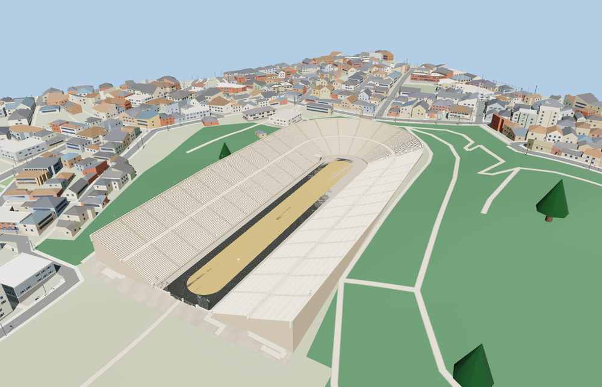

# Panathenaic Stadium

Panathenaic Stadium in Athens, with its open northwest forecourt, paired banks of marble seats, southeast horseshoe, historic tunnel portal, and black track around the tan infield.

The 53,355-triangle source rebuilds byte for byte. Skyline, district, street and close-up use 982, 3,989, 15,143, 52,871 triangles. The first two tiers total 398,576 bytes. Six GLBs validated and 38 current views were inspected.

Every tier clears 13 arena probes and ten seating probes. Nine entrance-grade checks are within 0.138 m and four wall probes confirm the base is closed. Three rays pass through the tunnel arch to the back of its visible vault. Twelve terrain samples outside the opening match the failed-load baseline. The viewer preserves 535 neighboring buildings and 262 road and path records. Failure or unload restores the original terrain.

The mapped seat and pitch polygons set the horizontal fit. Row heights, arena elevation, paving, flags and small details are reconstructed from the standard terrain and exterior photographs. The track and forecourt are modeled for exterior viewing. The tunnel has an open portal and a short visible vault. The unseen passage continues outside the model scope. Physical-device timings are unmeasured.

Rebuild with `node packages/worldgen/scripts/generate-panathenaic-stadium.mjs`. Append `--check` to compare exact bytes. Use `--ids=panathenaic_stadium` for targeted import, LOD, placement and readiness.
