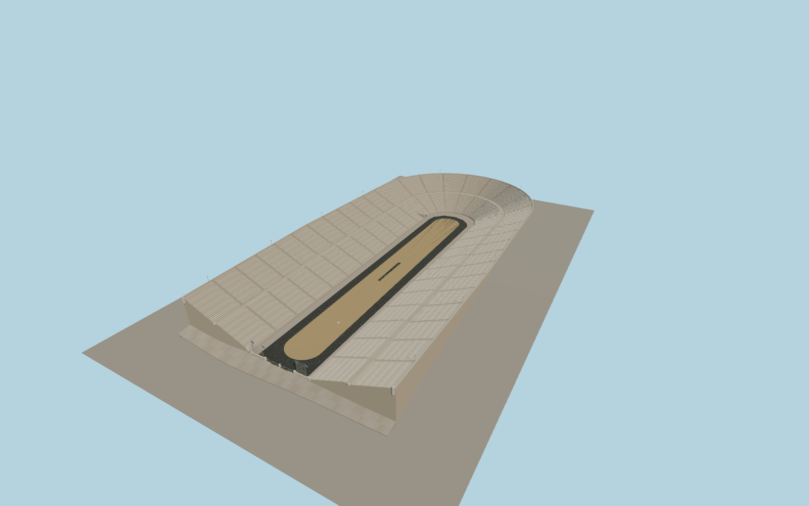

# Panathenaic Stadium

Panathenaic Stadium in Athens, with its open northwest forecourt, paired banks of marble seats, southeast horseshoe, historic tunnel portal, and black track around the tan infield.

Run `node packages/worldgen/scripts/generate-panathenaic-stadium.mjs` to rebuild the source master. Append `--check` to compare the exact bytes. Use `--ids=panathenaic_stadium` for targeted import, LOD generation and placement.

The mapped seat and pitch polygons set the horizontal fit. Row heights, arena elevation, paving, flags and small details are reconstructed from the standard terrain and exterior photographs.

The track and forecourt are modeled for exterior viewing. The tunnel has an open portal and a short visible vault. The unseen passage continues outside the model scope.

Original geometry follows the repository license. Map data is © OpenStreetMap contributors under ODbL-1.0 via Protomaps. Terrain samples are described in terrain-grid.json. Ordinary pictures stay local and are not redistributed or used as textures. Current acceptance is recorded in qa.json.
