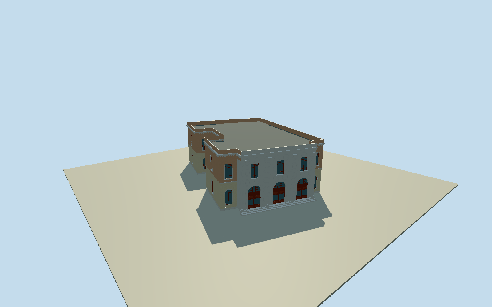

# Apollon Municipal Theater, Syros

Whole actual fifteen-control Apollon Municipal Theater/auditorium envelope with projecting marblethree-bayfront/three realroundarched shutredwood doors/opaqueglazed griddedfanlights/three tall upperwindows, four fullheightflutedmarblepilasters/capitals, peachupper-creamground sidewings/lowerarchedwindowrecesses, intrinsic three shallow frontsteps/dentilcornice/visible lowflatgreyroof/parapet and whole irregularrearbody/opennative side service recess. Two exactpublished2015creatorCC0 front originals; hiddenrear/roof/profiles/census/sections/currentfinefinish bounded estimates. No interior/ceilingpaintings/inscriptions/banner/bust/streetlamps/neighborhotel/publicpaving/trees/people/sourcepixels copied.

Authoring state: **review-in-qa.json**. Current completion evidence is in [qa.json](qa.json) and the [completion ledger](../../../../qualla-structures/batches/qualla-002.PROGRESS.md).

- [Apollon Theater, Syros](https://qualla.com/apollon-theater-syros/)

Whole native namedApollon Municipal Theater173785893/Q16327379, closed16point ring/fifteenunique controls. Exact actualbboxanchor/+Xeast/+Zsouth/heading0, wholeirregularauditorium/stage/rear envelope retained ratherthanfrontfacade-onlyrectangle. Nativeflatgreyroof/palebuildingcolour and three levels metadata; observed two-storey frontage, height/roof/hidden stages/census notsurveyed. All sourcefloor/section/roofchoices awaitoriginalindependentfieldfreeze.

All source floors/sections/geometry follow original400m129x12916641sample/one rawtile/fixedSW21.5244m provider-relative datum freeze. Whole native15control theatre envelope retained, actual projecting16m centralfrontnative2to3 and shorter flanking0to1/4to5 faces; side service recess stays open. Two published2015creatorCC0front originals inform originalphoto estimates: landing+.45m/three .15m risers, roundarched2.8mwide4.7mhigh shutdoors/.34m physicalreveal, lowerfacade5.75m/upper10.25m/cornice11.25m/lowflatgreyroof11m/parapet12.1m; four fullheightfluted marblepilasters. Three centralupper1.6x2.85mwindows and sideupperrect/groundarchedwindows, griddedredwood fanlights/closedpaneleddoors/opaqueglass. Nativeflatgreyroof/threelevels metadata does not establish surveyed hiddenstage/roof heights; hidden elevations/windowcensus/exact section/currentfinish bounded estimates. Sourcephoto inscription/bust/banner/noticeboard/streetlamps/publicpaving/art/interior notcopied. No terrainfit/flatten/reacquire/modelraising; preview/replacementfalse/exactfoundation and thresholds unresolved.

Two exactpublished2015ZachariasMitzelos/Zmitzieown-selfCC0 near/widefront originals individuallyinspected/nativeSHA1matched/passed unchanged publishedinventory. No supplemental/questionable imagery. Fourflutedpilasters/three mainarchedcloseddoors/fanlightwoodgrids/upperwindows/completewings/steps/roofparapet retained; hiddenrear/stage/roof/profiles/windowcensus/currentfinefinish/sections are bounded original estimates. Actualdoorbacks terminate exteriorrecesses; no auditoriuminterior reconstruction or traversalclaim. Sourceinscription/bust/ceilingpaintings/banner/lamps/publicpaving/trees/neighborhotels/houses/people/photo pixels notcopied.

Original400m129x12916641sample field/one rawtile/fixedSW21.5244m providerrelative datum frozen before all floors/sections/geometry. No terrainfit/flatten/reacquire/modelraising. Preview/replacementfalse/exact foundation/threshold contact unresolved. Isolatedflatground and syntheticneighbors are fixtures only.

Build: `node content/worldgen/source/places/sw/sw9/apollon_theater_syros/models/generate-apollon-theater-syros.mjs`. Add `--check` to verify exact regeneration. 11733 triangles; 6 materials; no embedded photographs.
