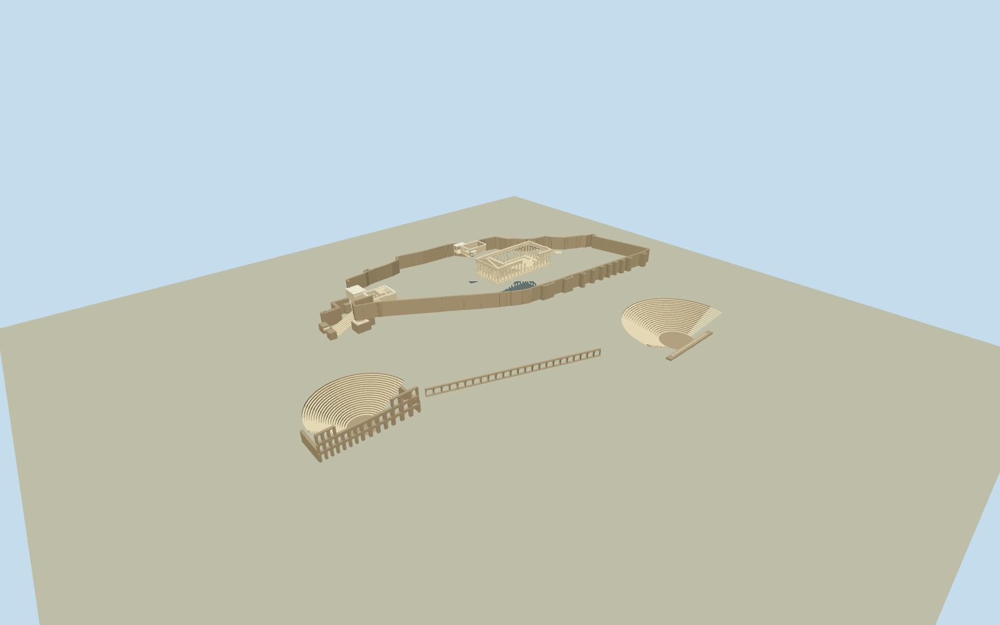

# Acropolis of Athens

Surviving Acropolis ensemble from native architectural component plans: roofless Parthenon/fluted peristyle and broken pediments, Erechtheion/Ionic porches/six Caryatids, monumental Propylaea, Nike/bastion, Beulé Gate/Agrippa, intrinsic stone fortifications/Roma ruins and lower-slope Odeon/Dionysus theatres/Stoa remains. Genuine open ruins and stage arches, original representative carved detail; no conjectural temple reconstruction or natural hill mesh.

Authoring state: **review-in-qa.json**. Current completion evidence is in [qa.json](qa.json) and the [completion ledger](../../../../qualla-structures/batches/qualla-002.PROGRESS.md).

- [Acropolis of Athens](https://qualla.com/acropolis-of-athens/)
- [Propylaea (Acropolis of Athens)](https://qualla.com/propylaea-acropolis-of-athens/)
- [Temple of Athena Nike](https://qualla.com/temple-of-athena-nike/)
- [Theatre of Dionysus](https://qualla.com/theatre-of-dionysus/)
- [undefined](https://qualla.com/parthenon/)
- [undefined](https://qualla.com/odeon-of-herodes-atticus/)

Original native OSM area supplies precise source coordinates for Parthenon287component members including42complete outer shafts/4broken shafts/inner shafts, surviving irregular cella walls, cornice and pediment fragments; Erechtheum31vertex envelope; Propylaea wall/opening/column multipolygon; Nike outer/inner temple controls; Beulé Gate/Agrippa; original fortification strips excluding natural-cliff members; Odeon and Dionysus/Stoa plans. Native mapped heights are estimates. Column centers/capitals and actual wall voids are retained; regular profiles/fluting and concealed ruination are authored estimates. Archaeological parcels/low foundations never become full buildings. Roof-tagged Parthenon polygons are only surviving pediment fragments, never a complete roof.

Architectural floor/seat/wall-height estimates constrained by inspected photographs and independent frozen raw source relief (datum118.0403m): Parthenon native center raw+28.31m, Erechtheum+24.99m, Propylaea+9.45m, Nike+5.17m, Odeon seating center-9.82m, Dionysus-3.65m. Entry terraces and marble platforms remain separate architectural floor estimates, not a fitted/flattened DEM or a claim of surveyed absolute heights.

Eight exact published Qualla originals actually inspected with native SHA1/explicit own-work CC0, PD-self or Adam Carr PD-user-en grants. Two Odeon originals are retained as source copies with primary release because old Qualla category metadata omitted its PD-self basis; no new imagery fetched. No questionable or other-licensed imagery used.

Complete surviving compound is interpreted at medium fidelity. Hidden elevations, floor/threshold differences, fortification sections, ruined crown profiles, masonry seams and detailed sculpture are estimates. Six on-site Caryatids are original representative draped figures, not a copy of museum artifacts. No roof is restored over the main temples. N0534 Hekatompedon, all conjectural archaic predecessors and Panathenaic Stadium are excluded.

Native exact architectural perimeters/columns control plan, but current restoration state may differ from mapped parts or dated photos. Temporary scaffolds/cranes and modern worksheds/lifts/museum are omitted. Surviving low foundations retain low heights; natural cliff-tagged wall members are excluded.

Raw source relief frozen separately before geometry at fixed west contact:118.0403m provider datum,800m grid, no flattening/fitting. Discontinuous rocky plateau is not constructed as an asset mesh. Distributed intrinsic masonry/temple platform levels remain approximate; exact host-terrain contact is unverified. Flat review stageY-23 shows the architecture without certifying its fit to any host DEM.

Build: `node packages/worldgen/scripts/generate-authored-places.mjs --ids=acropolis_of_athens`. Add `--check` to verify exact regeneration. 63951 triangles; 4 materials; no embedded photographs.
