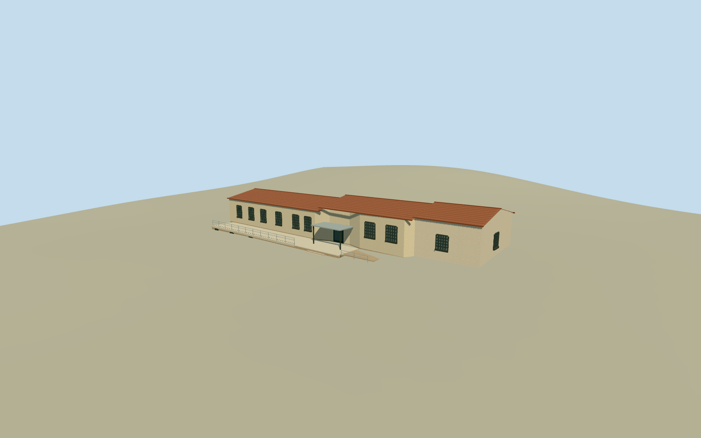

# Archaeological Museum of Eleusis

Long, pale stone museum above the sanctuary, with clay roofs and a stepped south terrace.

Authoring state: **review-in-qa.json**. Current completion evidence is in [qa.json](qa.json) and the [completion ledger](../../../../qualla-structures/batches/qualla-004.PROGRESS.md).

- [Archaeological Museum of Eleusis](https://qualla.com/archaeological-museum-of-eleusis/)

Standing historic museum exterior and attached approach. The clock tower and archaeological sanctuary have separate identities.

Roof heights, covered gallery detail, north-wall windows and narrow service links are representative.

Build: `node content/worldgen/source/places/sw/swb/archaeological_museum_of_eleusis/models/generate-archaeological-museum-of-eleusis.mjs`. Add `--check` to verify exact regeneration. 4018 triangles; 6 materials; no embedded photographs.
