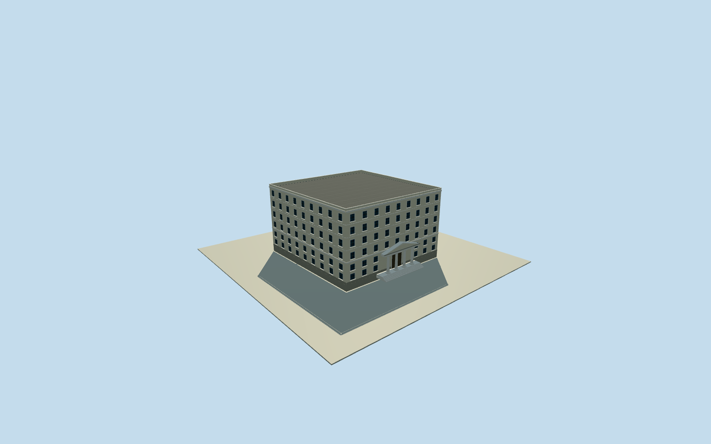

# Athens Stock Exchange — historic Sofokleous building

Complete named former exchange at8Sofokleous in approximate2015post-extension form: original nine-control full building, six-level office/hall/mezzanine interpretation, entire flat roof/parapet, all side/rear walls and monumental marble stair/column/simple-pediment entrance. Original owner/Ministry/OpenHouse written architecture and named native footprint; all imagery unused. Exact heights/floor interpretation/columncount/openings/roof/finish/grade explicitly estimated.

Authoring state: **review-in-qa.json**. Current completion evidence is in [qa.json](qa.json) and the [completion ledger](../../../../qualla-structures/batches/qualla-002.PROGRESS.md).

- [Athens Stock Exchange](https://qualla.com/athens-stock-exchange/)

Whole named former Athens Stock Exchange building at8Sofokleous within the8-10Sofokleous owner property, originalway234327978 entire nine-control envelope, all sides and roof, office superstructure and lower historic entrance/hall with marble stair, columns and simple pediment. Approximate post1965-1968extension2015 exterior. Adjacent independent NationalBank branchway234327993 and earlier1Pesmazoglou hall/current110Athinon headquarters excluded. All imagery unused; exact sections/roof/columns/openings/finish estimated.

Primary owner December2015 property record describes six-storey office building with two basements, ground and mezzanine,11,831.95m2 total on1,750.99m2 lot. Six nominal above-ground storeys are interpreted here as ground hall/mezzanine plus four office levels; the ambiguous source terminology is not an exact floor census. Native whole named exchange envelope retained; adjacent independent bank and earlier/current exchanges excluded. Owner table1896constructionyear conflicts with1931exchange design and is not used as an appearance date.

Original current named-building nine-control footprint is approximately registered to post-extension2015phase. No exact historical roof plan is claimed. The complete flat roof, parapet and all side/rear elevations are original bounded estimates; no courtyard/opening/extra rooftop structure is inferred without a source. Primary official entrance description supports marble stair, columns and simple pediment only: four columns, their plain capitals/flutes, portico projection, pediment section and all opening positions/counts are explicitly estimated, not observed or certified.

Independent original256m129x129 field,2raw tiles,16641values, datum96.0027m, range83.7975..98.9976m, frozen before floor or mainsections. Fixed original frontedge midpoint contact. Floor1.2m/foundation-1m/six0.2mstairs, main lowerhall8.2m, office roof23.4m/parapet24.4m fixed before geometry. Approximate urban relief can expose or bury bases; not a2015grade survey or datum conversion. Original field/frame/floors/sections never masked, cut, flattened, refetched or refit for screenshots.

Nominal roof/height uncertainty6m, plan/componentregistration uncertainty4m and ornament/columnsection uncertainty30percent. Flat roof, six-level interpretation, symmetric windows/bay counts, wall courses, cornices, cream plaster/marble/gray roof and glazing colors are procedural estimates from written facts, not photographic calibration. Closed doors; interiors, stained glass artwork, inscriptions, neighboring bank/campus and current110Athinon headquarters excluded.

All96Qualla image families checked first; no eligible exact-building image used. All imagery unused, including protected NationalBank archive photographs, official event images and modernCCBYSA exact-building photos. Original owner PDF written facts and Ministry/OpenHouse descriptions only; no photo-derived geometry, source-image textures or rights exemption.

Dated2015whole-building geographic proposal, currentWorldEligible false. Every LOD retains complete envelope, roof and monumental entrance; curvature/frames/cornices reduce with distance. Not a surveyed building or verified current replacement; vertical registration and exact ground contact remain unverified.

Build: `node content/worldgen/source/places/sw/swb/athens_stock_exchange/models/generate-house.mjs`. Add `--check` to verify exact regeneration. 5992 triangles; 6 materials; no embedded photographs.
