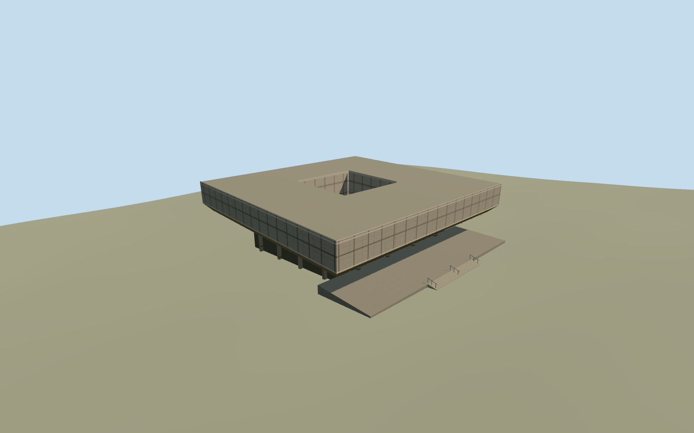

# Athens War Museum

The Athens War Museum at Rizari, with its deep concrete gallery cantilever, recessed glazed base, low entrance terrace and mapped central open atrium.

Authoring state: **review-in-qa.json**. Current completion evidence is in [qa.json](qa.json) and the [completion ledger](../../../../qualla-structures/batches/qualla-003.PROGRESS.md).

- [Athens War Museum](https://qualla.com/athens-war-museum/)

The outer footprint and central atrium follow the native mapped outlines. The undimensioned vertical section, canopy batter, lower window divisions and plaza approach are approximate.

The modeled extent includes the standing museum and its entry terrace. The yard exhibits, artwork, interior displays, and neighboring Byzantine and Christian Museum are outside its scope.

Build: `node content/worldgen/source/places/sw/swb/athens_war_museum/models/generate-athens-war-museum.mjs`. Add `--check` to verify exact regeneration. 2417 triangles; 7 materials; no embedded photographs.
