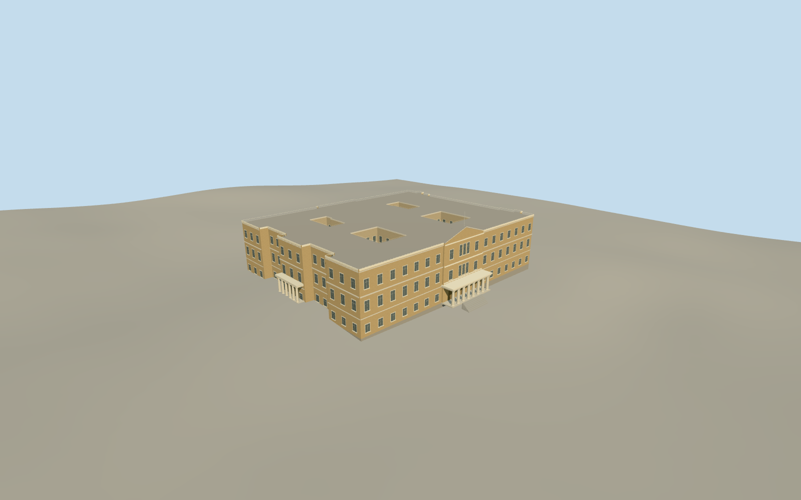

# Hellenic Parliament

Hellenic Parliament in Athens, with its ochre neoclassical palace wings, recessed entry doors, Doric porticos and shallow central west pediment.

Authoring state: **review-in-qa.json**. Current completion evidence is in [qa.json](qa.json) and the [completion ledger](../../../../qualla-structures/batches/qualla-003.PROGRESS.md).

- [Hellenic Parliament](https://qualla.com/hellenic-parliament/)

Building and parapet heights, local grades and roof details are estimated. The Syntagma side uses visible window counts and proportions from the exact originals. Equivalent rhythms and frames represent the sides and lightwells.

The model covers the Parliament building and attached entrances. The independently identified Tomb of the Unknown Soldier and plaza fountains are outside this structure.

Build: `node content/worldgen/source/places/sw/swb/hellenic_parliament/models/generate-hellenic-parliament.mjs`. Add `--check` to verify exact regeneration. 8799 triangles; 5 materials; no embedded photographs.
