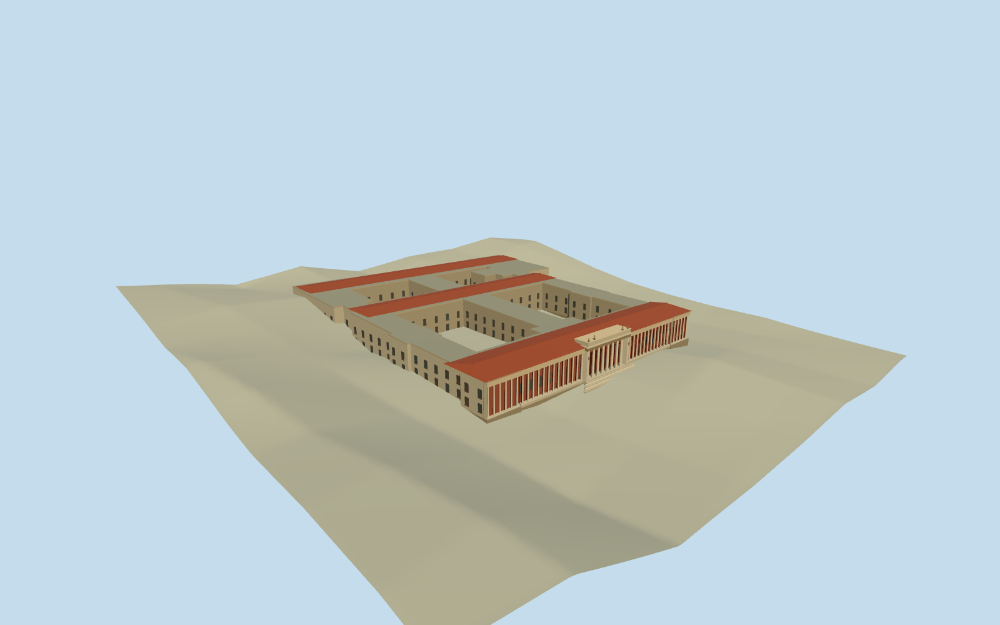

# National Archaeological Museum, Athens

The Athens National Archaeological Museum with the Ionic garden frontage and surviving four courtyards.

Authoring state: **review-in-qa.json**. Current completion evidence is in [qa.json](qa.json) and the [completion ledger](../../../../qualla-structures/batches/qualla-004.PROGRESS.md).

- [National Archaeological Museum, Athens](https://qualla.com/national-archaeological-museum-athens/)

The model represents the standing museum. Roof heights, less visible courtyard and rear elevations, sculptural figures and small details are estimates from the available evidence.

The original terrain is a 30 m surface dataset. Small steps and vegetation are below its resolution.

Build: `node content/worldgen/source/places/sw/swb/national_archaeological_museum_athens/models/generate-national-archaeological-museum-athens.mjs`. Add `--check` to verify exact regeneration. 23087 triangles; 7 materials; no embedded photographs.
