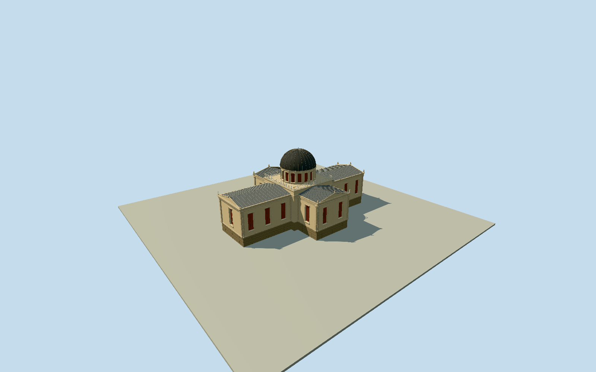

# National Observatory of Athens — Sinas Building

Whole historic Sinas/Hansen cruciform observatory: actual native18x27m cross with all20corners/212subdivisioncontrol envelope, pale neoclassical wings/raised stone basement, actual deep tall red shuttered recesses/pilasters/sills/cornices/four triangular pediments/acroteria/low metal wing roofs, closed recessed west entry/independent steps, central square terrace/open rails/red-windowed circular drum/closed ribbed dark metal rotating dome/finial. One cleared published2015creatorCC0 whole exterior plus two expired namedHansen plan/section sheets. Hidden/current finish/precise ornament/windowcensus/entryside/heights conservative original estimates. Separate circular observatory/admin/whole institution grounds/trees/hills/interiors/telescope/inscriptions/photo/page pixels excluded.

Authoring state: **review-in-qa.json**. Current completion evidence is in [qa.json](qa.json) and the [completion ledger](../../../../qualla-structures/batches/qualla-002.PROGRESS.md).

- [National Observatory of Athens](https://qualla.com/national-observatory-of-athens/)

Actual native cruciform building759263422/closed213point ring212controls matches whole2015photo and namedHansenhistoricalcross-plan. Nearby circular208073867/Q1816405 institution-labelled feature is physically separate9.2mround structure, not this18x27mcruciform Sinas building; do not substitute it or extrude institutional grounds. Whole original212controls retained in map-frame; many straight-edge subdivisions can be condensed geometrically without changing cross corners/extent in distant LODs. Common exact actualcross bbox anchor/+Xeast/+Zsouth/heading0. All source floors/sections/roof heights await independent field freeze.

All floors/sections/geometry follow original400m129x12916641sample independent sourcefield/two rawtile freeze. Fixed southapproach[0,17]92.0898m provider-relative floor0, no surveyed foundations. Actual native212subdivisioncontrol whole18x27m cruciform scope; collinear controls condensed to20corners within1cm for wall tessellation/distant levels without changing whole extent. Architectural vertical sections original photographic/Hansen-drawing proportion estimates: stonebasement1.65m, creamwalls6.05m/cornice6.35m, lowgabled wings7.12m, centralterrace7.22m, red-windowed circulardrum7.23..9.52m, closed ribbed dome12.58m/finial12.93m. Currentphoto governs exterior, historical cutaway interiors/telescope/terrain outline nevercopied. Eastend two red shuttered openings/triangularpediment; westend closed recessed entry, long-arm side window rhythm/cornerpilasters, four wing roofs/central terrace open rails/drum/dome. Main entry side/hidden elevation/currentfinefinish/ornament/section and precise census are original conservative estimates. No terrain fit/flatten/reacquisition/modelraising; sourcegrade exact thresholds unresolved, preview/replacementfalse.

Three exact published Qualla originals only:2015Jebulonown/selfCC0 whole exterior plus two expired namedTheophilHansen1813–1891 architectural plan/section sheets, individually inspected/nativeSHA1 matched/passed unchanged policy. Conflicting hero/unrelated NASA/celestial imagery unused without repair or reclassification. Current finefinish/hidden elevations/precise ornaments/entryside/sections/window census bounded original estimates. No copied photographic/page pixels, historical cutaway interiors/telescope/instruments/text, separate circular observatory/admin/grounds/landscape/neighbor buildings.

Original400m129x12916641sample field/two rawtiles fixed southapproach92.0898m provider-relative datum frozen before all floors/sections/geometry. No terrainfit/flatten/reacquire/modelraising. Preview/replacementfalse/exact foundation/threshold contact unresolved. Flat isolated ground and synthetic neighbors are review fixtures.

Build: `node content/worldgen/source/places/sw/swb/national_observatory_of_athens/models/generate-national-observatory-of-athens.mjs`. Add `--check` to verify exact regeneration. 25818 triangles; 6 materials; no embedded photographs.
