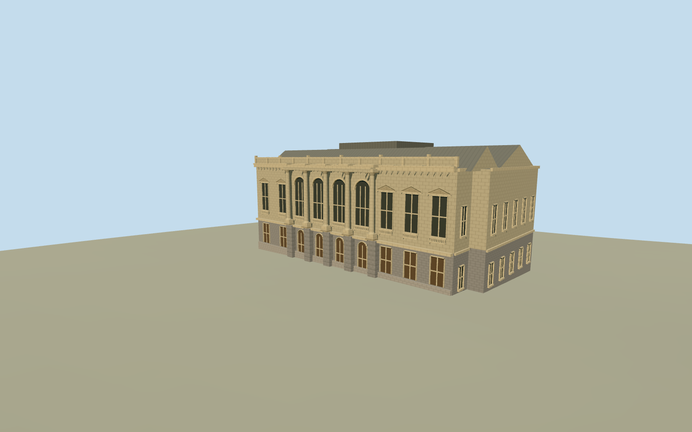

# National Theatre of Greece

Ernst Ziller’s National Theatre of Greece in Athens, with its pale arcaded main facade and rusticated base.

Authoring state: **review-in-qa.json**. Current completion evidence is in [qa.json](qa.json) and the [completion ledger](../../../../qualla-structures/batches/qualla-004.PROGRESS.md).

- [National Theatre of Greece](https://qualla.com/national-theatre-of-greece/)

The principal Ziller Building only. Separate venues and neighboring buildings are outside scope.

Published measurements of facade ornament, rear openings and roof heights were unavailable. Secondary elevations and fine ornament are approximate.

Build: `node content/worldgen/source/places/sw/swb/national_theatre_of_greece/models/generate-national-theatre-of-greece.mjs`. Add `--check` to verify exact regeneration. 6850 triangles; 6 materials; no embedded photographs.
