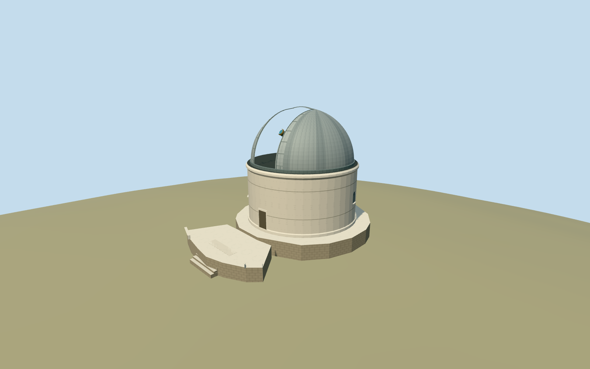

# Newall Telescope Observatory

Penteli’s marble Newall observatory with a 14-metre aluminum dome and the historic refractor visible at the open shutter.

Authoring state: **review-in-qa.json**. Current completion evidence is in [qa.json](qa.json) and the [completion ledger](../../../../qualla-structures/batches/qualla-003.PROGRESS.md).

- [Newall Telescope](https://qualla.com/newall-telescope/)

The permanent observatory footprint, crown diameter and general instrument form are grounded in primary evidence. Eave heights, exterior openings, dome shading and shutter framing are approximate.

The historic refractor is posed behind an open shutter and shown as a static visual reconstruction. Fine optical mechanics, the movable floor mechanism and surrounding campus buildings are outside scope.

The approach follows the mapped southern footprint, with simpler stair and pavement geometry over the original hill elevation.

Build: `node content/worldgen/source/places/sw/swb/newall_telescope/models/generate-newall-telescope.mjs`. Add `--check` to verify exact regeneration. 7702 triangles; 6 materials; no embedded photographs.
