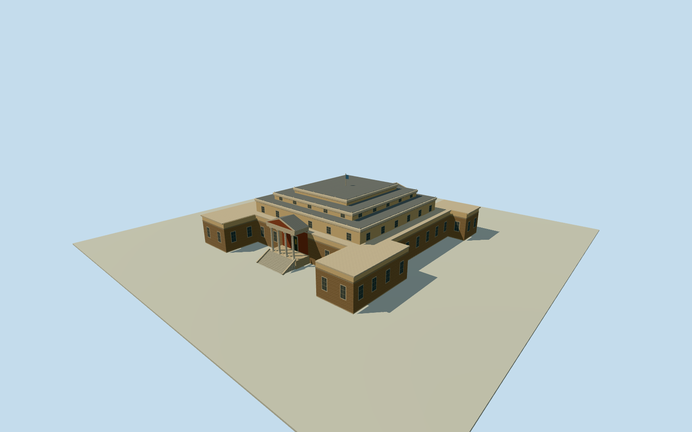

# Old Parliament House, Athens

Neoclassical Athens Old Parliament with two porticos, pale Ionic columns, rusticated ranges and layered roof parapets.

Authoring state: **review-in-qa.json**. Current completion evidence is in [qa.json](qa.json) and the [completion ledger](../../../../qualla-structures/batches/qualla-003.PROGRESS.md).

- [Old Parliament House, Athens](https://qualla.com/old-parliament-house-athens/)

Appearance represents the exterior in August 2014. The north court and portico follow the photographs, with ornament simplified.

The opposite entrance, rear and side fenestration, roof subdivisions and exact stair profiles are approximate. The mapped perimeter and unmodified terrain set placement.

Detached monuments, courtyards outside the footprint, freestanding furniture and interiors are outside the model.

Clearance and foundation measurements are representative. Geometry uses shared surfaces without photographic pixels.

Build: `node content/worldgen/source/places/sw/swb/old_parliament_house_athens/models/generate-parliament.mjs`. Add `--check` to verify exact regeneration. 8340 triangles; 5 materials; no embedded photographs.
