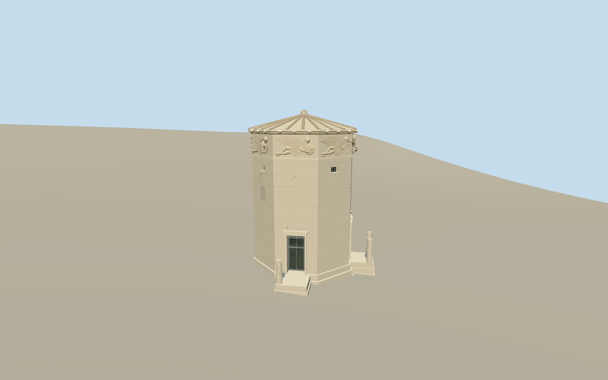

# Tower of the Winds

Surviving octagonal Pentelic marble tower with variable stone courses, two deep north doorways with metal grilles, eight shallow rightward-flying winged wind reliefs and simplified attributes, sundial lines, projecting cornice/lion spouts,24-slab low pyramidal roof with radial joint covers and broken capital, three stepped base courses, ruined porch platforms/three column stumps and open broken southern reservoir annex. Missing porch roofs/full columns/Triton vane not restored.

Authoring state: **review-in-qa.json**. Current completion evidence is in [qa.json](qa.json) and the [local 100 ledger](../../../../qualla-structures/batches/PROGRESS.md).

- [Tower of the Winds](https://qualla.com/tower-of-the-winds/)

Current surviving exterior uses exact named photographer Ownwork/self-CC0 natives after Qualla-first41paths. Earlier attribution/private/aerial image controls are historical and excluded. Built physically curved/segmented ochre roof joint covers, closed stepped cornice and lion-mask spouts with real recessed mouths. Full fixed octagonal tower/eight wind reliefs/porches/ruined annex retained. Main sideabout3.25m and almost9m wall guide scale; top13.16m including broken capital is an authored elevation estimate. Exact courses, roof/cornice profiles, wind sculpture contours/poses/depth, threshold and damage remain estimates, not scans.

Two ruined porch platforms/three column stumps and broken open southern annex retained; full porch columns/pediments, complete reservoir and bronze Triton not restored. Eight low-relief wind figures keep winged flying poses and coarse attributes; two less-documented poses and fine face/cloth details are conservative original interpretations. No source photographic pixels embedded or redistributed. Interior water-clock mechanism, detached fragments, interpretation furniture and surrounding ruins/stairs/walls excluded.

Independent terrain retained unchanged. Archaeological ground may not be resolved by coarse urban DEM; north steps/doors and southern annex contact reviewed as a bounded preview, footprint replacement disabled.

Build: `node packages/worldgen/scripts/generate-authored-places.mjs --ids=tower_of_the_winds`. Add `--check` to verify exact regeneration. 54446 triangles; 5 materials; no embedded photographs.
