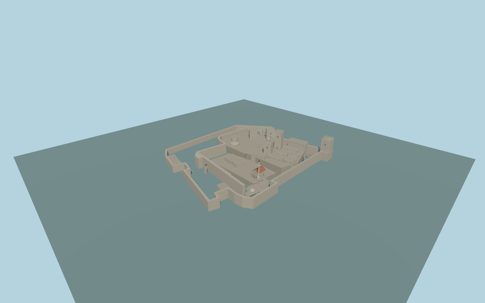

# Bodrum Castle

Complete original Bodrum coastal fortress: irregular hollow outer/double curtain walls, open stepped baileys, separate French/Italian/English/German/round/D-shaped towers, low museum ranges, Gothic tile-roof chapel with pale minaret and low bath dome; mapped entrance paths remain physically open.

Rebuild checked-in source with `node packages/worldgen/scripts/generate-bodrum-castle.mjs`; append `--check` for exact bytes. Import and LOD selection: `--ids=bodrum_castle`. GLBs are ignored outputs; detailed master and four browser tiers remain separate.

The retained Q1113602 perimeter is a hollow curtain wall, not a solid roofed building. Separate towers, open courts and all21 native owned components are represented. The French47.5m above-sea envelope is38.5m at the approximate9m model datum. Other tower/roof/gateway/terrace/accessibility levels, fine names and opening inventories are original picture proportions, not as-built measurements. Six existing256px material graphs are shared without private or embedded images. Full scope/current review: model-brief.json and qa.json.

Original geometry uses the repository license. Maps: © OpenStreetMap contributors, ODbL-1.0; Protomaps. Standard terrain attribution: terrain-grid.json. Ordinary reference photographs remain local and are not redistributed or used as textures.
