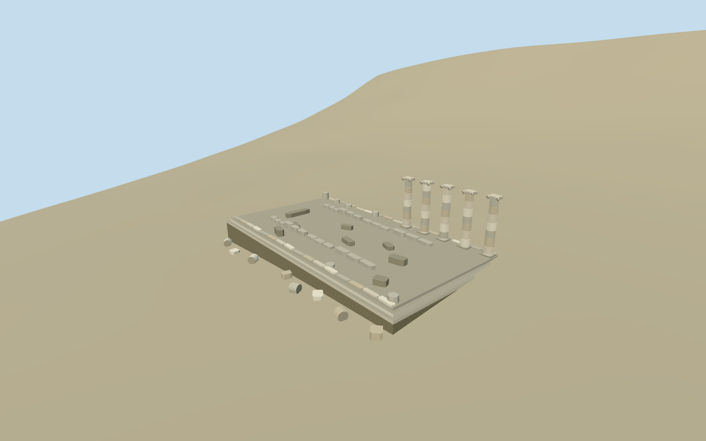

# Temple of Athena Polias (Priene)

Five restored weathered Ionic columns with irregular drum joints and volutes above the stepped marble platform and broken cella of the Athena temple.

Authoring state: **review-in-qa.json**. Current completion evidence is in [qa.json](qa.json) and the [completion ledger](../../../../qualla-structures/batches/qualla-003.PROGRESS.md).

- [Temple of Athena Polias (Priene)](https://qualla.com/temple-of-athena-polias-priene/)

The mapped 14.0 m ruin width is narrower than the surveyed 19.52 m stylobate. Greater width comes from the architectural measurement, with its center relative to mapped remnants approximate.

The exact five column centerpoints within the northern row, individual fragment positions, cellular wall remnants and modern visitor-ground details require interpretation. The southern temenos walls, altar and Propylon are outside the temple model.

The public elevation is preserved, but coarse source terrain cannot resolve individual stones or the original stepped paving.

Build: `node content/worldgen/source/places/sw/swe/temple_of_athena_polias_priene/models/generate-temple-of-athena-polias-priene.mjs`. Add `--check` to verify exact regeneration. 11566 triangles; 3 materials; no embedded photographs.
