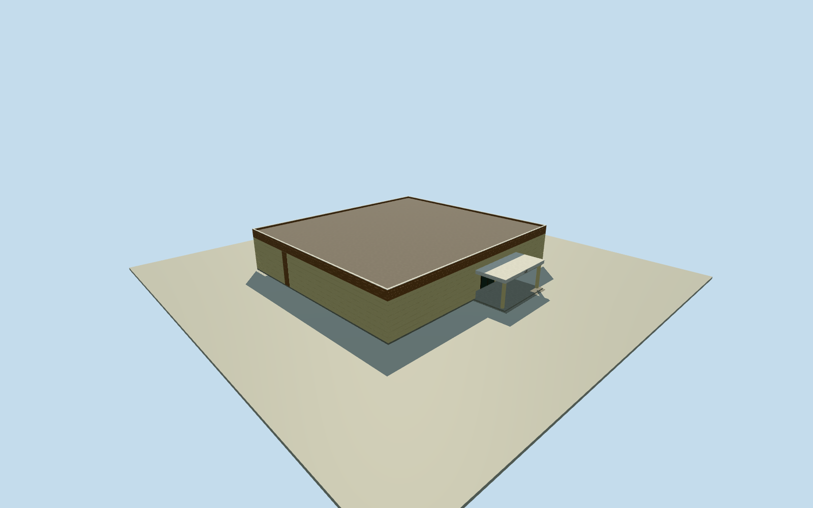

# Akhisar Museum

Single-storey exhibition hall with cream walls, a brown upper band and a white two-column portico.

Authoring state: **review-in-qa.json**. Current completion evidence is in [qa.json](qa.json) and the [completion ledger](../../../../qualla-structures/batches/qualla-003.PROGRESS.md).

- [Akhisar Museum](https://qualla.com/akhisar-museum/)

OpenStreetMap way 1411083878 supplies the four original corners of the main exhibition hall. Qualla’s three exact CC0 photographs from February 2025 establish the white north portico, cream wall courses, brown upper panels and recessed glazed entry.

Model height, canopy depth, door width, plain secondary elevations and the flat roof concealed by the brown parapet are original estimates. The camera EXIF locations support the north entry but have metre-scale position uncertainty. Coarse DEM contact and threshold geometry remain approximate.

Scope is the single-storey exhibition building. The administration building, storehouse, gate, trees, loose exhibits and interiors remain outside the asset.

The independent 128 m terrain field was preserved before choosing the floor and geometry. The original surface was sampled without flattening or height adjustment. No reference pixels are embedded.

Build: `node content/worldgen/source/places/sw/swg/akhisar_museum/models/generate-house.mjs`. Add `--check` to verify exact regeneration. 1320 triangles; 5 materials; no embedded photographs.
