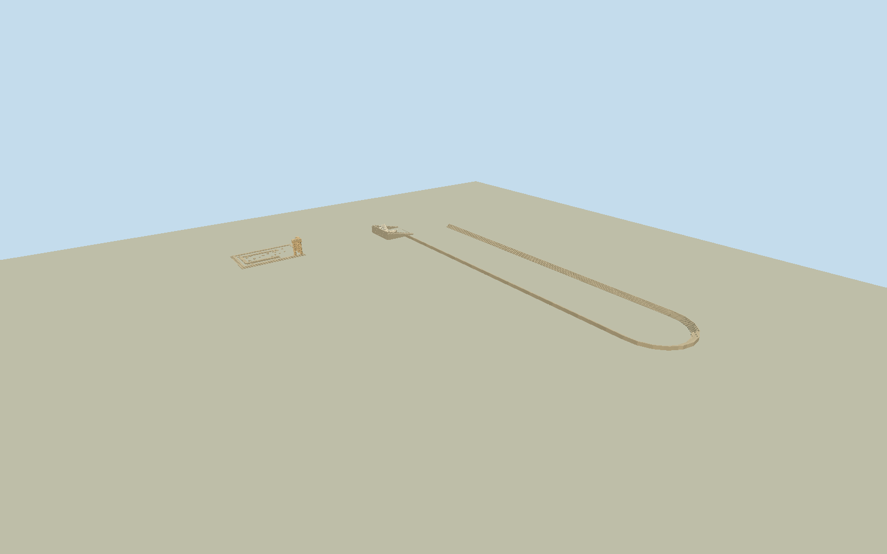

# Acropolis of Rhodes (2011)

Three principal contiguous surviving monuments in the Rhodes Acropolis archaeological park: whole native Apollo temple platform with three standing Doric shafts/L-shaped entablature/fourth broken shaft and low foundation remains; complete restored rectangular east-facing Odeon with open orchestra, lower10/upper9 stone seat tiers, radial stairs, walkway, retaining walls/side ramps; and whole long stadium surviving low stone seating banks/curved south end/open north end. No lost temple roof/cella/peristyle, intact Classical reconstruction, other park sanctuaries/gymnasium/library/underground shrines, precinct ground/bedrock/trees/stadium-earth slab, visitors/scaffolds/signs or city. This bounded three-monument ensemble is not every archaeological feature in the wider Acropolis. Preserve original complete three physical envelopes and the open ground between them. Temple is roofless three standing columns plus one shorter broken shaft, L-shaped entablature, low perimeter/foundation remains, original fragmented broad foundation courses. Odeon concrete-backed restoration has two sectors of pale seats with real radial stair aisles and broad walkway, no theater roof/stage building. Stadium is open north, side steps and closed curved south end, no dirt/grass floor mesh or giant stadium slab. Freeze independent512m129²field before geometry; intrinsic monument levels approximately sampled from fixed raw field, no fitted/flattened ground. Use dated2011 appearance; subsequent Apollo dismantling/restoration not certified current.

Authoring state: **review-in-qa.json**. Current completion evidence is in [qa.json](qa.json) and the [completion ledger](../../../../qualla-structures/batches/qualla-002.PROGRESS.md).

- [Acropolis of Rhodes](https://qualla.com/acropolis-of-rhodes/)

Original OSM TempleApollo324703585/Q30503687 complete4-point platform, Odeon1498049947 complete5-point rectangle with collinear split, Stadium1498394922/Q30503700 complete13-point surviving perimeter. Native archaeological envelopes bound plan extent, not surveyed individual stones/seat curves/column centers or original ancient complete buildings. Fixed anchor at joint three-envelope bbox center and +X along original temple long edge east-northeast/+Z south-southeast. Apollo standing corner/ruin strips, odeon seating partitions and stadium stone-bank widths are bounded original photo interpretations inside the original footprints; individual hidden pieces and vertical levels estimated, no invented whole park masonry.

Bounded three-monument2011ensemble, not every feature in the wider Acropolis. Full original4/5/13physical envelope vertices retained. Other sanctuaries/library/gymnasium/grottoes are outside this model; no complete ancient roof/cella/colonnade, imaginary intact theater or stadium superstructure.

Historical-only observed2011appearance; Ministry2025text confirms subsequent Apollo dismantling/restoration.2011-04-16represented date/conservative2025-01-01upper viewing cutoff does not assert exact demolition date or certify2011..2024unchanged detail. No default current-world activation. Native current archaeological envelopes are coarse plan controls, not a2011survey.

Apollo3standing columns/1broken shaft/corner L-shaped entablature/low stepped masonry and fragmentary foundations interpreted from exactCC0photos; corner,8.3m shafts/.88mradius/4.25m spacing, fine flutes/capital/frieze/chip/coursetop estimates. Exposed bedrock not modeled, arbitrary isolated architectural fragment positions representative and not an artifact survey.

Odeon lower10rows/five cunei/four aisles, upper9rows/four cunei/three aisles,5.5morchestra supported by scholarlytext; actual restored structure represented with curved seats, walkway/parodos walls and side ramps.19x.31mverticals, seat depth/.68mwalkway/hidden side/rear details estimated; no ancient roof or invented stage elevation. Stadium7lowrows/3.85mbank width/side stair census are bounded photo estimates. Original13point stadium enclosure is retained; long and curved banks are polygonal, open earth/grass racing floor not a GLB slab.

Qualla-first52families/zero conflicts; one exact publishedJebulonCC0original then four samecreator ownCC0originals individually inspected/nativeSHA1matched. No questionable/licensed imagery, protected ministry/diazoma drawings/photos, photo textures or media-metadata/policy edits. Shared sandstone/raw and weathered limestone graphs with original vertex colors.

Independent512m129²16641samples/four originalTerrariumtiles frozen before geometry unchanged.74.5335mprovider-relative north-approach datum; original source DEM about3.84moutput pixel spacing may oversample much coarser data. Approximate temple/odeon/stadium horizontal levels from frozen provider field, not surveyed2011grade. Coarse composite rises across stadium rather than a surveyed level running floor, so native host contact remains unverified; no field fitting/flattening/reacquisition. Portable/shared/context flat fixtures separate and cannot prove geographic ground contact.

Build: `node packages/worldgen/scripts/generate-authored-places.mjs --ids=acropolis_of_rhodes`. Add `--check` to verify exact regeneration. 48980 triangles; 4 materials; no embedded photographs.
