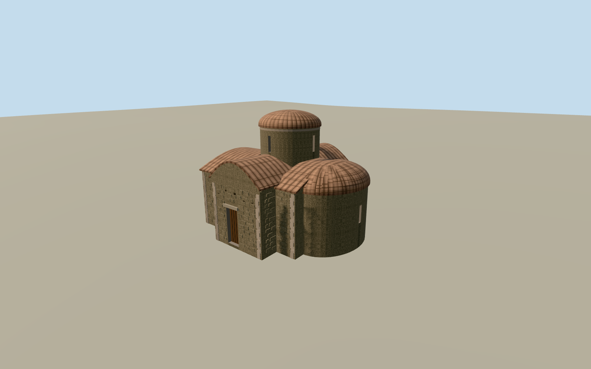

# Church of Saint Euphemianos, Lysi

Rubble masonry chapel with tiled barrel roofs, a cylindrical dome drum, semicircular apse and recessed plank side door.

Authoring state: **review-in-qa.json**. Current completion evidence is in [qa.json](qa.json) and the [completion ledger](../../../../qualla-structures/batches/qualla-003.PROGRESS.md).

- [Church of Saint Euphemianos, Lysi](https://qualla.com/church-of-saint-euphemianos-lysi/)

The rectangle sets the overall dimensions. Offsets, curves, heights, masonry courses and individual tiles are estimated from the two June 2010 exterior photographs.

The north and west elevations are simplified continuations of the documented walls and barrel roof. The roof form and openings are an exterior interpretation.

The original terrain is preserved. Foundation embedment and threshold registration are approximate. The appearance is scoped to the 2010 photo year.

Build: `node content/worldgen/source/places/sw/swp/church_of_saint_euphemianos_lysi/models/generate-lysi-chapel.mjs`. Add `--check` to verify exact regeneration. 8845 triangles; 5 materials; no embedded photographs.
