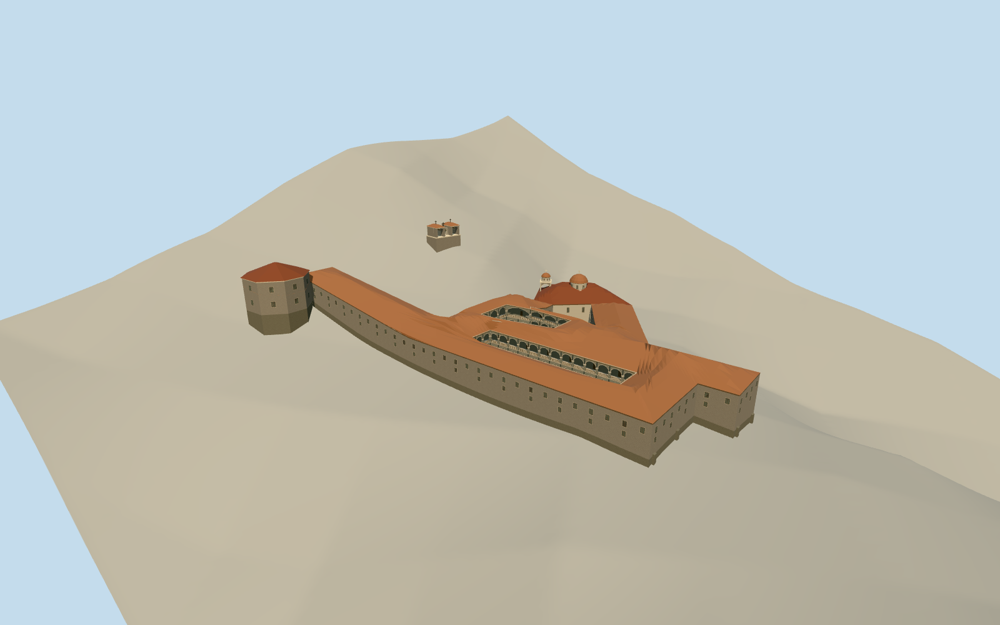

# Kykkos Monastery

Kykkos Monastery in the Troodos mountains, with arcaded rubble-stone courts, clay-tile roofs, a domed basilica and the 1882 mountainside campanile.

Authoring state: **review-in-qa.json**. Current completion evidence is in [qa.json](qa.json) and the [completion ledger](../../../../qualla-structures/batches/qualla-003.PROGRESS.md).

- [Kykkos Monastery](https://qualla.com/kykkos-monastery/)

Building envelopes follow the native mapped monastery, church, paved court, independent belfry and octagonal museum end. The lower well court is an estimate within the mapped envelope.

Staff and visitor rooms, roof heights and pitches, belfry and dome sections, approximate courtyard levels and patterns of exterior openings are inferred from public-domain reference photographs, the visitor guide and the original elevation samples.

Only the architecture is modeled. Wall painting, mosaic designs, objects in the museum and church interiors are absent.

The original Copernicus field is unmodified. Its roughly 30 m horizontal sampling cannot resolve steps, finished paving, adjacent terrain cuts and small retaining walls.

Build: `node content/worldgen/source/places/sw/swp/kykkos_monastery/models/generate-kykkos-monastery.mjs`. Add `--check` to verify exact regeneration. 26123 triangles; 6 materials; no embedded photographs.
