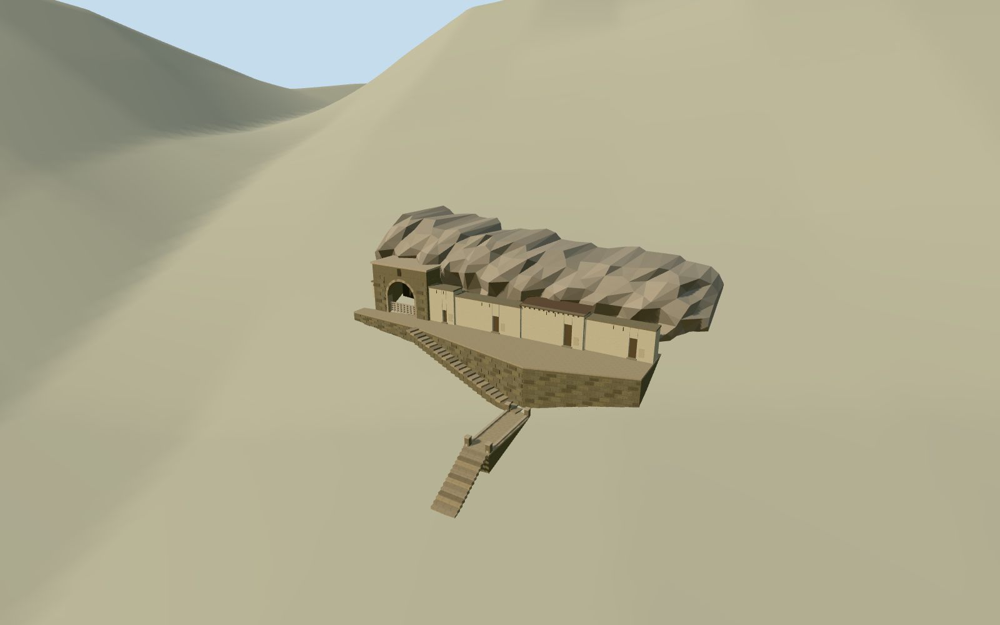

# Saint Neophytos Enkleistra

The hermitage and chapel at the Enkleistra of Saint Neophytos in 1888, with the cliff, arched stone screen, elevated terrace, stairs and the ravine crossing.

Authoring state: **review-in-qa.json**. Current completion evidence is in [qa.json](qa.json) and the [completion ledger](../../../../qualla-structures/batches/qualla-004.PROGRESS.md).

- [Agios Neophytos Monastery](https://qualla.com/agios-neophytos-monastery/)

The model represents the historic Enkleistra exterior and immediate approach. The later main church on the other bank is a separate building.

The exact form within the deep cliff, the outer passage, stair widths, retaining-wall details, geological surfaces and material colors are inferred from the archive view and mapped dimensions.

June 15 is a representative date within the documented 1888 journey year. The original caption does not give a calendar day.

Build: `node content/worldgen/source/places/sw/swp/saint_neophytos_enkleistra/models/generate-saint-neophytos-enkleistra.mjs`. Add `--check` to verify exact regeneration. 5934 triangles; 6 materials; no embedded photographs.
