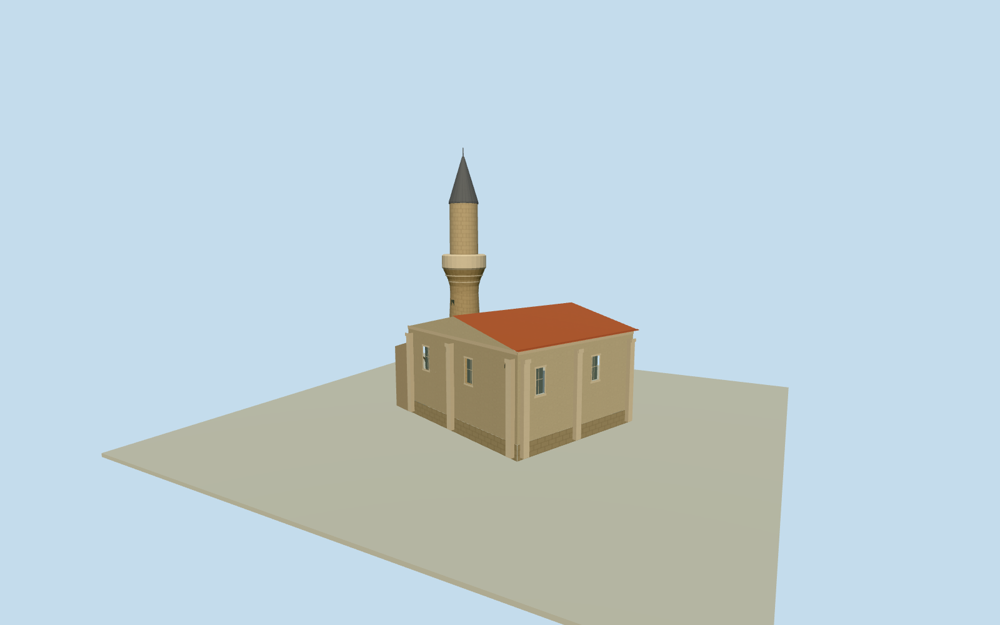

# Bayraktar Mosque

Bayraktar Mosque on Constanza Bastion in Nicosia, with its compact tiled stone hall and tall limestone minaret crowned by a corbelled balcony and tapered roof.

Authoring state: **review-in-qa.json**. Current completion evidence is in [qa.json](qa.json) and the [completion ledger](../../../../qualla-structures/batches/qualla-003.PROGRESS.md).

- [Bayraktar Mosque](https://qualla.com/bayraktar-mosque/)

The reconstruction covers the mosque as photographed in April 1999. Constanza Bastion is recorded for geographic context.

The source elevation field resolves the hilltop grade at low resolution. Local wall footings and approaches use estimated heights.

The south-facing walls and minaret proportions follow the published photograph. Positions of individual openings, far wall details and roof connections are approximations.

Build: `node content/worldgen/source/places/sw/swr/bayraktar_mosque/models/generate-bayraktar-mosque.mjs`. Add `--check` to verify exact regeneration. 1488 triangles; 6 materials; no embedded photographs.
