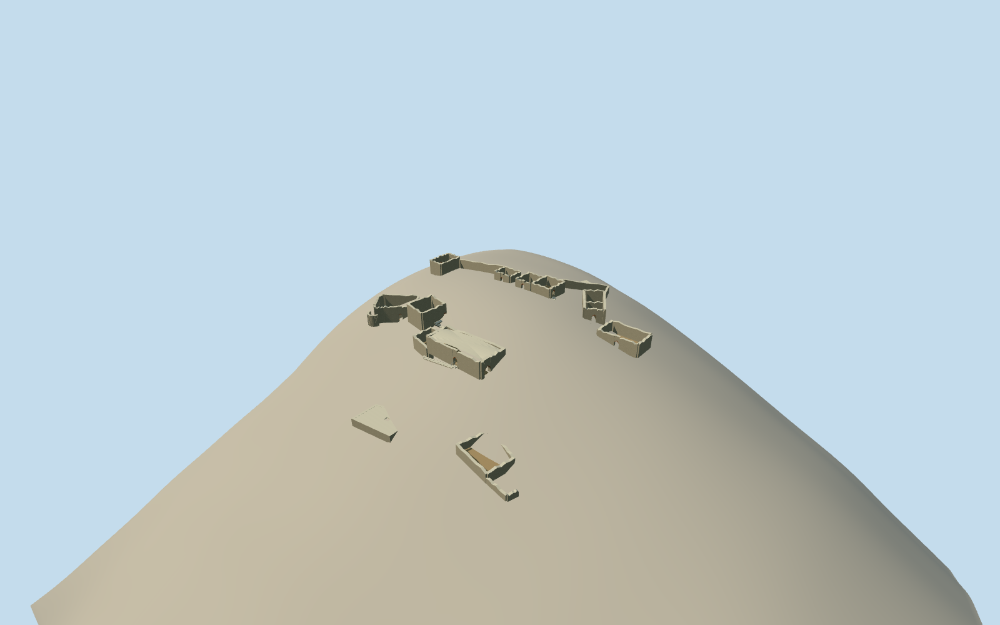

# Buffavento Castle

Whole13-partBuffavento ruinedcastle architecturalassembly: entrance/gatetower/partialgroinvault, lowerbalcony/hall/Byzantinehousing/roundedbay, bothoutlyinghollowcisterns/stableoutwork, fullintrinsicwindingstairs, upperchapel/barracks/westroomrange/northplateauwall. ClearedpublishedPDwholeplan andexactownCC0ruinphoto, singleexplicitapproximategeographicplanregistration. Nointactkeeporwholemountainsolid; naturalhillsidegapsretainoriginalfield. Hiddenruinprofiles/verticalsections/floors/roofsurvival/staircounts/registration explicitestimates.

Authoring state: **review-in-qa.json**. Current completion evidence is in [qa.json](qa.json) and the [completion ledger](../../../../qualla-structures/batches/qualla-002.PROGRESS.md).

- [Buffavento Castle](https://qualla.com/buffavento-castle/)

Nativewholecastleextentway102190298/Q301376/14controls and distinctintracastlepaths663444686/663444685/final23546943. Siteextent isnotbuildingperimeter; physicalwallsderivedfromreleasedwhole13-partplan under explicitapproximateone-scaleregisteredtransform. Naturalhill/gapsretainoriginalproviderfield.

Whole surviving Buffavento Castle ruined architecturalassembly, preserving all13diagram parts: easternpointed entrance/gate tower, lowerward balconybuilding/largehall/Byzantinehousing/roundedbay, both outlyingcisterns and stableoutwork, complete intrinsiclower-to-upperstairs, uppercentralchapel/barracks/westroomrange/northernplateauwall. Bound originalestimatedruin sections, retainopenbrokenwalls andnaturalhillsidegaps. Not a solid siteparcel/hill, genericintactcastleorpartialphotographedroom. Entire external600stepapproach/roads/memorial/trees not castle model.

Originalfieldfrozenfirst, thenfixedoriginalestimatedruinsections/floors. Provider-relativefloors from pregeometryfield/three-zoneplan topology: gate+.3m, balcony-2.3m,large0m,Byzantinehousing-4.4m,lowercistern-14.2m,stable-8.7m,upperrooms+1.8..6.4m,chapel+4.1m/barracks+2.6m,northcistern+2.1m. Theseareunclassifiedcoarsehillside visualizationestimates, notsurveyedactualsteps/floors. Ruinwalls2.3..5.8m, wallthickness.75m/gatetower1m, brokenwallcrownsoriginalboundedjaggedprofiles. Gatefirststoreypartialvault estimate, otherroofssurvivingprofileunverified/roofless. Whole intrinsicstairsfixedbetweenroomlandingsbeforegeometry, risermax.2m; longexternal600stepapproachexcluded. No laterfield/floor/mainsection fitting.14nativeextentcontrolsnotwallcoordinates; singlepublicplanuniformscaleoriginalregistration remainsapproximate.

Whole13partreleasedplanretainedunderoneuniformsimilaritytransformusingmanuallyhypothesizedupperrow/path-endpointcorrespondence. Nativeextent14controlsisnotroomwallgeometry. Wholeplanhasno metric/verticalsurvey; actualruinheight/windowcensus/roofsurvival/daylightmaterial/currentconservation/floors/railplacements explicitlyoriginalestimated. Exact2024ruinphoto roomID notindependentlybound; onlymasonry/cappedtops/arch/stepappearance adopted. Nodrawingtext/art/sculpture/completeintactmedievalcastle fabricated.

Originalfield/frame/allfloors/mainsections frozenbeforemesh; coarseDEMprovider-relativepeaksdifferfrompublishedsummitaltitudes. No surveyedaltitude/contact/thresholdclaim. Modelrooms/cisterns/stepshavephysicalindividualgroundopenings, naturalhillgapsremain; sourceelevationsneverreplaced/fitted. Geographicpreview/replacementfalse. External600stepapproach/roads/memorial/trees remainoutsideasset.

Build: `node content/worldgen/source/places/sw/swr/buffavento_castle/models/generate-buffavento.mjs`. Add `--check` to verify exact regeneration. 6384 triangles; 6 materials; no embedded photographs.
