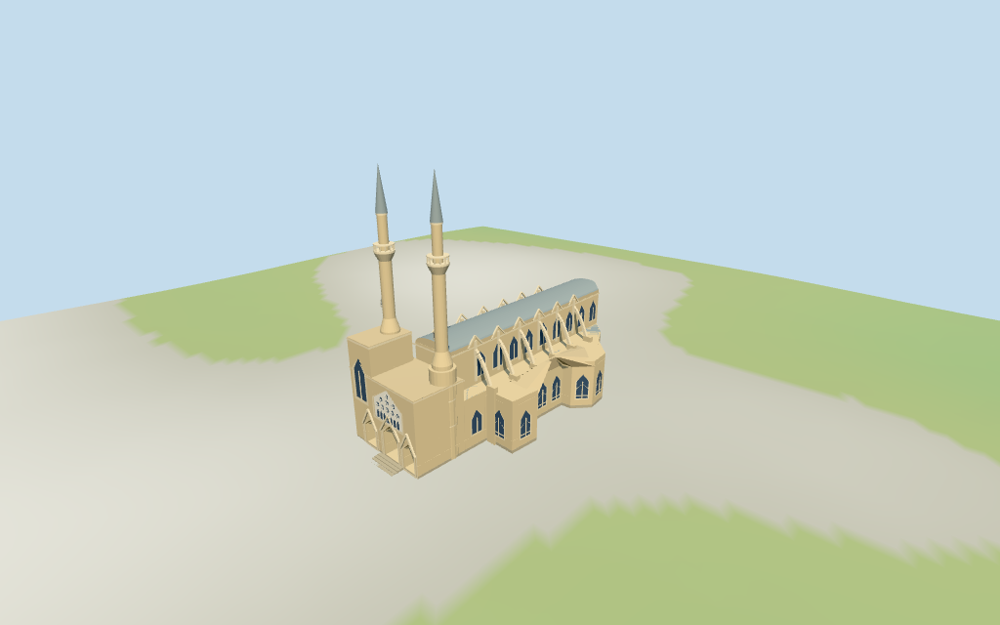

# N0337 — Saint Sophia / Selimiye, Nicosia: current exterior review

Reviewed 2026-10-14 against current source/runtime bytes. Accepted for the medium-fi exterior and approximate geographic scope below. The stable planned ID names the former cathedral; the authored exterior represents its present-day Selimiye Mosque identity.

## Built result

Inspected all 11 final portable/source-terrain frames. Current Selimiye Mosque is represented under its planned Saint Sophia Cathedral identity: twin minarets/single balconies, asymmetric northern square bay and southern round base, three recessed Gothic porch arches/closed doors, pale pointed screen, low vaulted nave/aisles, small gable crests/flying buttresses and polygonal eastern/annex envelope. Tightened the southern porch opening to retain its outer jamb. Roof subdivision and annex functions remain approximate.

Individual medium-fi present-day Selimiye exterior from useful elevated/west/detail photographs, a2025 post-restoration material/entrance view and standard viewer PMTiles/DEM. No usable architectural height facts or roof/minaret parts. Generic parent11m reflects three building levels and is not a measured cathedral height. Main23m eave/25m low vault,13m aisle,18.5m porch,26m square tower,64m minaret tips and all balcony/profile/annex dimensions are picture-led estimates. Exact fretwork/sculpture, flags, loudspeakers, finials/crescents, full interiors, market/neighboring buildings and surveyed thresholds excluded. Physical laptop/phone timing pending.

## Shared materials and placement

Inspected all 11 final shared-material/geographic frames. Five existing 256-square graphs supply sandstone/raw-stone walls, trim and foundations, standing-seam lead, wood doors and pale plaster screen. Corrected the screen from the glass role to solid trim so its shared plaster graph is applied. Metric UVs and linear tints; glass remains flat blue-gray. Each graph reads once. Unload disposes model geometry and restores ground. Flat placement fixture matches the signed outline; native heightmap views complement coarse ground-fit review using diagnostic ground colors.

One unioned current parent and retained exact-QID way28958071 preserve the full approximately79x41m envelope. Clipped architectural zones cover that complete outline. Twin western minarets versus eastern polygonal end resolve signed heading0.097520545779rad; asymmetric northern square bay/southern round base distinguish the facade. Native standardDEM148.685587m and estimated0.7m floor clear coarse perimeter−0.216..0.312m. Component positions, foundation/plaza/steps and thresholds remain approximate; no road replacement or certified walking surfaces.

Inspected all 27 final Earth-lighting frames: Economy/High, noon/late, three distances, silhouette, six details, four matched levels and four transitions. Skyline retains twin minarets, asymmetric western masses and low nave. District restores actual porch arches, shared textures and balcony outlines; street restores flying arches, gable crests and selected screen pattern; closeup refines shafts, vault, railings, mullions and rosette spokes. Detail/profile changes remain visible. English-terrace neighbors are synthetic context, not a reconstruction of Nicosia.

## Browser budgets

| Level | Triangles | Bytes | Draws |
| --- | ---: | ---: | ---: |
| skyline | 599 | 61044 | 1 |
| district | 1591 | 149892 | 8 |
| street | 3705 | 340628 | 8 |
| closeup | 5959 | 541840 | 8 |

Skyline plus district: **210936 bytes** of geometry. Detailed source master: **748140 bytes / 6195 triangles**. No embedded images; five shared graphs are cached separately. Separate POSITION/NORMAL streams report equal CPU/GPU buffer totals. Initial geometry excludes shared graph definitions and procedural texture generation. Physical phone/laptop timings remain pending.

## Verification

- Targeted source generation with --ids=N0337 --check reproduces current source bytes.
- Source/import/derivative hashes match. All six GLBs pass Khronos with zero errors, warnings or embedded images.
- 53 imported geometry probes pass: porch recesses/jambs/closed doors, pale screen/selected rosette/northern pane, low vault/aisle roofs, both shafts/balconies/caps/supports and steps. Porch and door checks repeat in district, street and closeup outputs.
- Current parent polygons, signed geographic transform, retained exact-QID outline and standardDEM grid match. Clipped zones reproduce the complete mapped envelope. Declared estimated tip heights agree across all outputs; this does not establish actual real-world heights.
- Solid screen uses the trim role; all five shared graphs load once and unload leaves zero live model geometries.
- Source inventory/schema and source-frame/medium-fi readiness bindings pass.
- Scene validation and 30-tick simulation pass: sha256:55e65e5fe4bb44ad26590973c3245ecaa9a34cfc3cb9c1b6d34eac6c648808b6.
- Inspected 49 current frames: 11 portable, 11 shared/placement and 27 medium-fi. Bound reports retain paths, hashes and cameras; bulk images stay local/ignored.

Source hash: sha256:298018780d92e5413170d1e46bb21020e682fd60169da0b7440c0d006faa74ec. Runtime hash: sha256:5f3a46f651e875114177476e00c7d40eedd40d70517b21ca1ad543ee4d201df3. Input hash: sha256:ddf27f3a36c796240d585f7e3d3436079c49e988e7946068e6a29a8b23ae9e5c.

Commands: targeted generator/import/LOD scripts; capture-next-1000-models.mjs --ids=N0337 --reflections --antialias --fit-shadows; capture-landmark-library.mjs --ids=N0337 --reflections --adaptive-clipping --bounded-placement; capture-medium-fi.mjs --ids=n0337_saint_sophia_cathedral --reflections; molen validate and molen sim run --ticks 30 --hash. This model used the targeted authoring loop.

## Limits

- No retained published height facts or PMTiles tower/roof parts. Current parent height11m is a generic building/three-level value and conflicts with the pictured cathedral/minarets; it is not treated as an architectural measurement. Main23m eave/25m low vault,13m aisle,18.5m porch,26m square west tower,10.5/11.5m annexes,64m minaret tips and all balcony/radius splits are picture-led estimates, not surveyed heights. Whole mapped79x41m envelope controls horizontal scale; component positions are approximate reconstructions within it.
- Current Selimiye Mosque exterior from useful pictures and standard viewer PMTiles/DEM. NativeY0 follows148.685587m standardDEM; estimated floor0.7m clears coarse perimeter-0.22..0.31m. Main/minaret heights, porch/annex roles, foundation/plaza/step joins remain approximate; no surveyed thresholds or certified walking surfaces.
- Current Selimiye mosque exterior is represented under its stable former-cathedral candidate ID. Screen rosettes,lancets,portal hoods and balcony profiles are selected approximations; no exact fretwork,sculpture,flags,loudspeakers,finials/crescents,full interiors,market stalls or neighboring buildings. Roof subdivision and annex functions remain unverified. Closed recessed doors and open porch cuts do not certify walking surfaces. Physical laptop/phone timing pending.
- Skyline uses closed porch masses,mean-tinted materials and coarser minaret/vault facets. District restores actual porch arches,shared textures and balcony outlines; street restores flying arches,small gables and selected screen pattern; closeup refines shafts,vault/arch facets,balcony bars and rosette spokes. Detail/profile changes remain visible.

Readiness is visual acceptance for this stated scope, not a survey or a complete walkable interior. The original 1,000-candidate goal remains incomplete.
