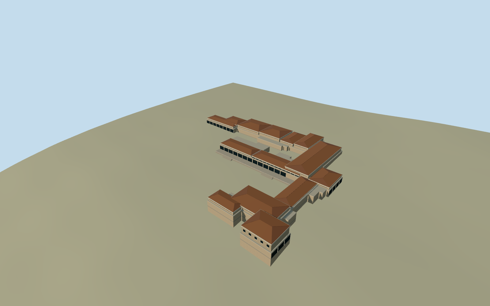

# Antalya Museum

The original Antalya Archaeological Museum as seen in June 2024. Its layered tile-roofed galleries and enclosed lapidarium wrap the large southern exhibition garden.

Authoring state: **review-in-qa.json**. Current completion evidence is in [qa.json](qa.json) and the [completion ledger](../../../../qualla-structures/batches/qualla-003.PROGRESS.md).

- [Antalya Museum](https://qualla.com/antalya-museum/)

This dated model shows the building that opened in 1972 in its later form, with the renovations recorded by the city. Pre-renovation features, enclosed exhibits and the replacement project are outside the modeled scope.

The old perimeter is mapped. Roof heights, number and placement of individual roof units, window rhythm, color tones and paving are estimates from written records and visible geometry in the survey outline.

The viewer date range begins at the documented map revision and ends when the original museum closed to visitors in July 2025. The building was subsequently demolished in September.

Build: `node content/worldgen/source/places/sw/swt/antalya_museum/models/generate-antalya-museum.mjs`. Add `--check` to verify exact regeneration. 3469 triangles; 7 materials; no embedded photographs.
