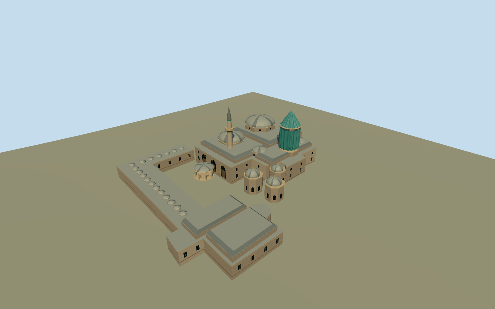

# Mevlâna Museum

The standing Mevlâna Museum in Konya, with its turquoise sixteen-fluted tower, lead domes, single minaret and dervish-cell court.

Authoring state: **review-in-qa.json**. Current completion evidence is in [qa.json](qa.json) and the [completion ledger](../../../../qualla-structures/batches/qualla-003.PROGRESS.md).

- [Mevlâna Museum](https://qualla.com/mevlana-museum/)

Model depicts the standing historic exterior. Lower roof junctions, most small window openings and the exact terrace and paving courses are approximations.

The cube and cylindrical drum follow documented proportions and the native roof plan. Fine polychrome tile and inscription detail are simplified.

The nearby two-minareted Selimiye Mosque is a separate landmark. The map control includes it to disambiguate the museum.

Build: `node content/worldgen/source/places/sw/swx/mevlana_museum/models/generate-mevlana-museum.mjs`. Add `--check` to verify exact regeneration. 15389 triangles; 7 materials; no embedded photographs.
