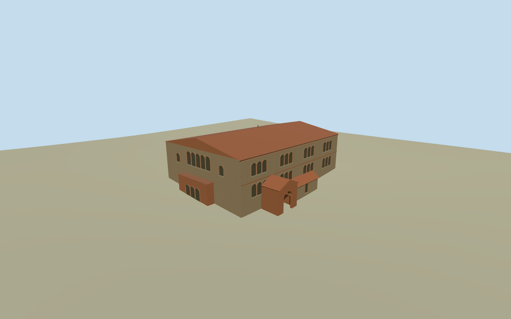

# Church of the Acheiropoietos

The early Byzantine basilica at Thessaloniki, with paired levels of round-headed windows, south propylon and eastern apse.

Authoring state: **review-in-qa.json**. Current completion evidence is in [qa.json](qa.json) and the [completion ledger](../../../../qualla-structures/batches/qualla-004.PROGRESS.md).

- [Church of the Acheiropoietos](https://qualla.com/church-of-the-acheiropoietos/)

The exterior standing basilica, south entrance and apse. Interior mosaics and the Roman bath archaeology are outside scope.

Upper wall heights, exact roof pitches and concealed details are estimated from the photographs.

Build: `node content/worldgen/source/places/sx/sx0/church_of_the_acheiropoietos/models/generate-church-of-the-acheiropoietos.mjs`. Add `--check` to verify exact regeneration. 7444 triangles; 8 materials; no embedded photographs.
