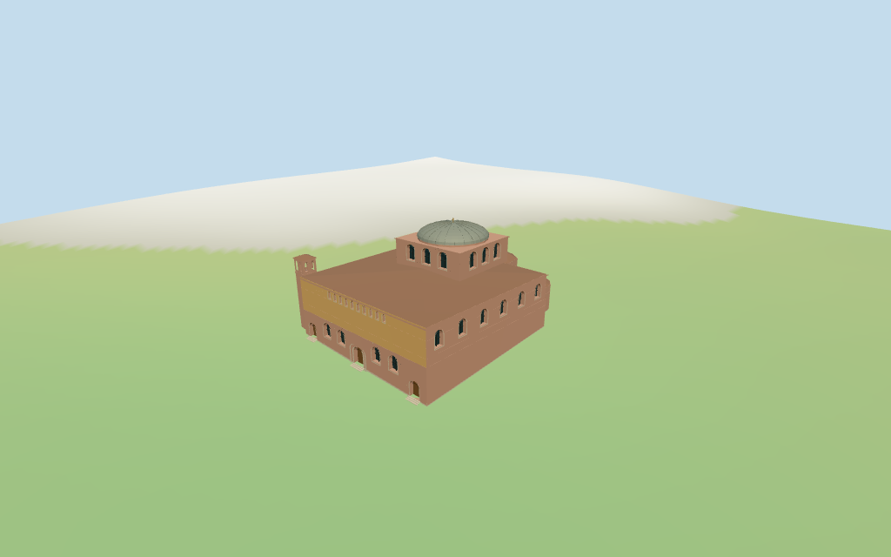

# Hagia Sophia

Individual medium-fi Hagia Sophia in Thessaloniki: ochre west upper facade and exposed warm masonry lower/east walls, three west doors with a broad round central portal, four lower arched window fields and a narrow upper clerestory row. Square brick drum with large arched glazing, short round crown and low ribbed gray-green metal dome/cross. Low red tiled main roof, large polygonal eastern apse with smaller side apses, and northwest small bell tower/open paired arches and hip cap. Retained mapped plans and terrain-following footings. Separate unmapped courtyard gateway/retaining wall/fence, surrounding town/landscaping, exact carved reliefs/icons/text, interiors and certified walking excluded.

## Evidence and reconstruction

Published dimensions and reconstructed details are separated in spec.json. Primary references:

- [Reference](https://commons.wikimedia.org/wiki/File:THESS_-_Aghia_Sophia_01.JPG)
- [Reference](https://commons.wikimedia.org/wiki/File:Saint_Sophia_Church,_Thessaloniki_(east_side).jpg)
- [Reference](https://commons.wikimedia.org/wiki/File:Αγία_Σοφία,_Θεσσαλονίκη_3859.jpg)

Six existing shared256-square lime plaster, running-bond brick, flat tile, standing-seam metal, limestone and plain wood graphs. Ochre front, warm masonry, red tile and gray-green metal use linear tints/metric UVs. Dark glass/grille and gold accents are flat PBR vertex colors. Zero embedded images, bespoke facade textures or baked weathering/shadows.

## Model and axes

13,512 triangles; 40,536 vertices; 8 material groups; 1,626,000 bytes. Native bounds: -24.332, -2.754, -21.963 to 23.188, 21.400, 17.544. Source hash: `sha256:f50bbf50ad23d8fe966114a6a77da704149c7e617a33d72823454a39b8890f6c`.

{"x":"east-southeast toward apses","y":"up","z":"south-southwest"}

Standard DEM datum24.401000m; display datum offset0.4m, perimeter terrain-2.40..1.69m. Foundations follow terrain; west entries use local DEM+0.22m and short estimated steps. The source does not flatten terrain or certify the sunken courtyard/retaining edges, absolute altitude, thresholds, cut/fill, interiors or walking.

## Reproduce

Run `node packages/worldgen/scripts/generate-additional-landmarks.mjs --ids=hagia_sophia_thessaloniki` (or add `--check`). The generator preserves manually edited masters by checking their baseline hashes. Import through the standard authored-model workflow with optimization disabled; then capture all QA cameras, including shared-surface views.

## Pending work

- Retained exact-QID OSMway27715355/Q1568660 matches current main35184399804187. Six unscaled main/part/tower controls retain every raw tag and missing min_height. Main11m and northwest bell14m are current map heights; the retained main describes3building levels with no measured height. Both central square and round controls are tagged17m and share the modeled drum-top datum rather than being stacked as two17m solids. Low roofs,8.8m central apse,5.7m side apses, body/drum divisions, bell openings and dome/cross above17m are picture-led estimates; no surveyed dimensions claimed.
- Standard DEM datum24.401000m; display datum offset0.4m, perimeter terrain-2.40..1.69m. Foundations follow terrain; west entries use local DEM+0.22m and short estimated steps. The source does not flatten terrain or certify the sunken courtyard/retaining edges, absolute altitude, thresholds, cut/fill, interiors or walking.
- Medium-fi exterior from two clear west/east photographs plus an older street context and standard viewer PMTiles/DEM. Exact carved portal reliefs/icons, inscriptions, door/grille finework, separate unmapped courtyard gateway/retaining wall/fence, surrounding town/landscaping, full interiors and certified walking excluded. Physical laptop/phone timings pending.
- Skyline retains the low dome/cross, square drum, small open bell, three eastern apses and roof tiers. District adds shared textures, flat glazing/doors and paired open bell arches. Street adds recessed windows/entries, portal arch bands, sparse mullions/grilles and dome ribs. Closeup/master refine arch/dome facets and ribs. Foundations and local entry steps approximate coarse standard terrain; synthetic context neighbors are not mapped Thessaloniki buildings.

This bundle follows the medium-fi standard. Medium-fi appearance and geographic fit are reviewed separately. Hash-bound visual acceptance is recorded separately after capture inspection.

## Additional geographic data

©OpenStreetMap contributors; Protomaps; Mapzen/USGS terrain tiles.
