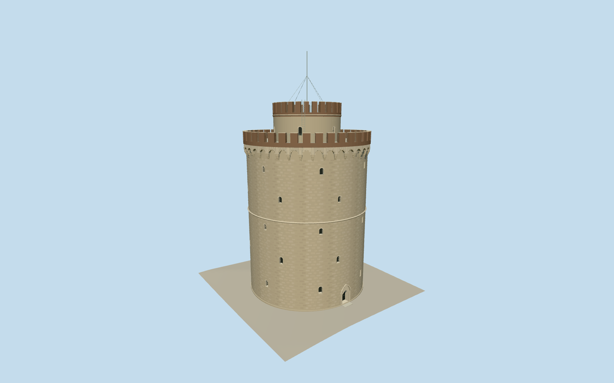

# White Tower of Thessaloniki

Warm weathered cylindrical stone fortification with sparse recessed arched windows, pointed street entrance, cordon, genuine arched corbel niches, brick crenellations, annular terrace around narrower upper turret, safety grilles and axial mast. Surviving standalone tower; former enclosure walls/plaza and interiors excluded.

Authoring state: **review-in-qa.json**. Current completion evidence is in [qa.json](qa.json) and the [local 100 ledger](../../../../qualla-structures/batches/PROGRESS.md).

- [White Tower of Thessaloniki](https://qualla.com/white-tower-of-thessaloniki/)

Current medium-fi exterior uses the exact cleared Qualla Ktrepas2019 photographer CC0 native and exact named photographer CC0/public-domain originals. Earlier attribution/private/museum/aerial reference controls are historical and excluded. Closed physical arch voussoirs/spandrels and stepped corbels rebuilt from inspected current natives. Operator33.9m masonry height/21.7m body diameter retained. Map root22.9m corbel/12m upper diameter are controls, not survey. Exact window distribution, profiles, masonry pattern, threshold and mast fittings remain estimates.

Physical window/door recesses at district and above. Skyline retains entry recess and simplified26/20-merlon crenellated silhouette but replaces arched corbels with a broad projecting band and omits small windows/grilles. Main entrance represented closed; no playable or surveyed interiors. Flags, cars/trees, signs, interpretation furniture, former outer enclosure and plaza excluded.

Bounded32m land preview uses independently reproduced DeltaDTM v1.1.1 original one arcsecond coastal heights, resampled at1m; not a surveyed site/floor or a1m source. Existing geometry and dry reference unchanged. Rejected Terrarium retained. Sea and surrounding square excluded; no NODATA filling, flattening, cutout or footprint replacement. Another host field requires contact review.

Build: `node packages/worldgen/scripts/generate-authored-places.mjs --ids=white_tower_of_thessaloniki`. Add `--check` to verify exact regeneration. 51212 triangles; 6 materials; no embedded photographs.
