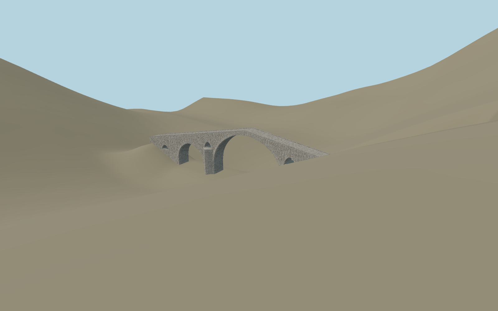

# Dyavolski Most (Devil’s Bridge)

Individually reconstructed Arda crossing with three unequal major vaults, four separate flood openings, upstream pointed cutwaters, irregular mineral stone masonry, exposed stone soffits, steep humped cobbled walkway and extremely low stone edges.

## Evidence

- [Primary reference](https://www.tourism.government.bg/sites/tourism.government.bg/files/bulletin_5_march_2019_eden_iii_edition_english.pdf)
- [Primary reference](https://basa-architecture.eu/_files/osnovna_tqlo_2023_compressed-1.pdf)
- [Primary reference](https://doi.org/10.3390/buildings14010054)
- [Primary reference](https://commons.wikimedia.org/wiki/File:Bulgaria-Diavolski_most-01.jpg)
- [Primary reference](https://commons.wikimedia.org/wiki/File:Bulgaria-Diavolski_most-02.jpg)
- [Primary reference](https://commons.wikimedia.org/wiki/File:DJI_vp3.jpg)
- [Primary reference](https://www.openstreetmap.org/way/58478181)

Published dimensions and reconstruction assumptions are separated in spec.json. Source photos were consulted; no photos or third-party geometry are embedded. Map plan attribution: © OpenStreetMap contributors, ODbL-1.0.

## Source

519774 triangles; 41927756 bytes; 1 material groups. SHA256: sha256:680c05c0da168a676a954b82224d077cdfa36ecb309e265781efd17f345059a7.

Shared surfaces (stone_granite) are loaded through the central library; any transparent materials use local PBR parameters. Axis and provisional vertical datum are in spec.json.

Regenerate with node packages/worldgen/scripts/generate-researched-bridges.mjs --ids=dyavolski_most; append --check to verify. Import and capture through the standard structure-catalog scripts. Geometry validation does not substitute for current-frame visual review.

## Reconstruction limits

- Owner picture/PMTiles approximate placement scope; no bespoke survey or source research.
- Original stone-by-stone master remains unchanged and byte-reproduced; one shared granite graph retains metric texture/roughness and vertex tint variations, with zero embedded images.
- All four browser levels use stable independent seven-opening arch bodies; metric shared weathered-stone texture replaces individually modeled stones. Source retains the original granite graph and masonry master. Published56/65.7m vs59.092m map length disagreement stays explicit.
- Coarse PMTiles gorge/approach terrain differs about20m across the crossing. Bounded contact fixture and ground opening prevent obvious burial; exact riverbed, bank fit and modern scenery are unverified approximations. Footprint replacement off; physical-device timing remains pending.
