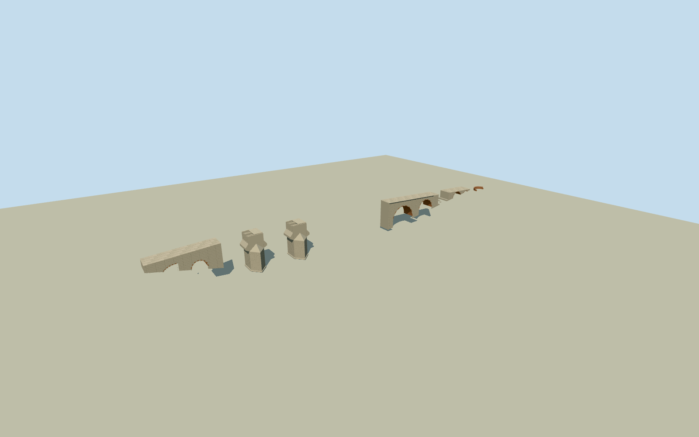

# Aesepus Bridge

Surviving ruined Aesepus/Güvercin bridge: two detached granite piers/pointed cutwaters and four true longitudinal hollow chambers between five upper masonry walls, broken deck/arch springers, western small bank arches and eastern58mramp with genuine open stone/brick vaults, partial arch9ruin, bounded paving and low intrinsic east brick exedra/stonecolumn. Four main vaults and conjectural third pier absent, no restored intact bridge or river terrain mesh.

Authoring state: **review-in-qa.json**. Current completion evidence is in [qa.json](qa.json) and the [completion ledger](../../../../qualla-structures/batches/qualla-002.PROGRESS.md).

- [Aesepus Bridge](https://qualla.com/aesepus-bridge/)

Original native named ruins node1817148418/Q409720and two adjacent man_made=bridgeways1015750743/744 establish the crossing identity, aggregate surviving-site envelope and signed east-axis bearing. Their continuous filled map polygons are NOT evidence of surviving road decks across the already collapsed main spans, exact pier footprints or a158mancient survey. Original native polygons are preserved as context only; do not extrude them. The cleared1906published elevation/photo controls give documented separate piers/abutted bank arches; complete158mlength/5.6mwidth are independently reported by the2020primary field study. Final measured-elevation digitization/repeat heights/hidden section and158mregistration relative to current partial map envelopes are explicit medium-fi estimates.

Published58measternramp and158moverall span govern coarse extents; relative registration of detached piers/western remnants is approximate against the current aggregate native envelope. The1906elevation is not a metric plan. East ramp arch9(third east minor opening) is conjectural/overgrown, retained only as a broken low section; never an intact invented arch.

Five1905/1906Hasluckphotographs and contemporary elevation are already published QuallaPD-old-100-expired originals, nativeSHA1matched/primaryrelease bound and all6actually inspected. Primary2020fieldstudy text only corroborates current surviving piers/arch/chambers and dimensions. Its restricted modern photos/figures and uncreditedManyas4were not used. No external bitmap generated or photo texture copied; original medium-fi geometry and shared material graphs.

Two current native bridge polygons are aggregate crossing envelopes, not intact load-bearing road surfaces across the missing river arches. Four main spans and conjectural third pier remain genuinely absent at everyLOD. Arch9is explicitly uncertain/overgrown and retained only as low discontinuous fragments, not a completed invented vault. The low east exedra/80cmcolumn are intrinsic reported remains with approximate placement.

Broad geometry follows the cleared surviving1906forms corroborated by2020fieldwork, but recent small losses, upper jagged courses, floor levels/riverbed depth, original stone/brick census, bank-arch spacing and detached-pier registration are estimates. Permanent nominal158mlength/5.6mwidth and58meastramp are coarse controls, not a full measured3Dsurvey. Natural river/ground/bank/valley and the nearby modern highway are excluded.

Independent raw source terrain is preserved without flattening or fitting, fixed east-bank reference chosen before geometry. Exact dry-bank/river footing and compatible host water datum remain unverified approximate geographic preview; flat reviewY-11.1shows the intrinsic ruins.

Build: `node packages/worldgen/scripts/generate-authored-places.mjs --ids=aesepus_bridge`. Add `--check` to verify exact regeneration. 10208 triangles; 4 materials; no embedded photographs.
