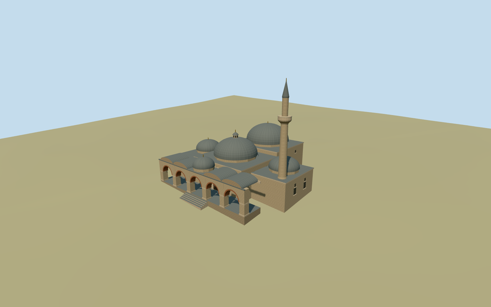

# Muradiye Mosque, Edirne

Muradiye Mosque in Edirne with four lead domes, a five-bay arched porch and one stone minaret.

Authoring state: **review-in-qa.json**. Current completion evidence is in [qa.json](qa.json) and the [completion ledger](../../../../qualla-structures/batches/qualla-003.PROGRESS.md).

- [Muradiye Mosque, Edirne](https://qualla.com/muradiye-mosque-edirne/)

Architectural descriptions and mapped outline inform the standing exterior. Individual drum, eave and minaret heights, the exact portal detail and trim colours are estimated.

The current stone minaret is represented. The separate lodge, courtyard fountain, burial grounds, historic tilework and interior are outside the model scope.

Original Terrarium heights preserve the hill slope. Steps, paving, retaining walls and the immediate ground around the mosque are simplified.

Build: `node content/worldgen/source/places/sx/sx6/muradiye_mosque_edirne/models/generate-muradiye-mosque-edirne.mjs`. Add `--check` to verify exact regeneration. 9679 triangles; 5 materials; no embedded photographs.
