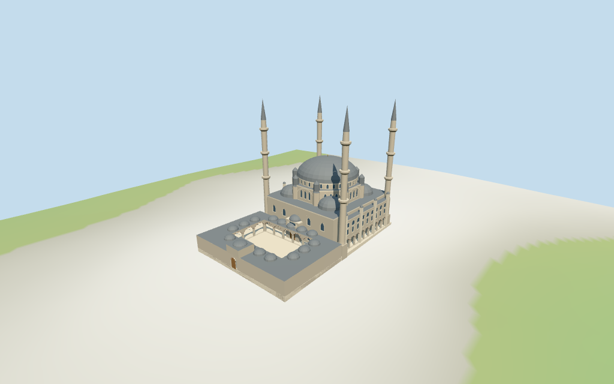

# N0420 — Selimiye Mosque

Reviewed 2026-10-16 against current bytes. Accepted for stated medium-fi exterior and approximate horizontal fit. Nominal/picture heights,subplans,fine architecture/current finish and exact terrain/site joins retain explicit limits.

## Exterior and shared surfaces

Inspected all 11 current portable views, including the 1024×640 summary. Single broad grey dome and window drum on a stepped octagonal support, eight small capped buttress turrets, four slender three-balcony minarets, four corner exedra caps and low domed court. Open pointed courtyard arcades, striped arch surrounds, two-level side facades with open lower galleries and raised hall/northwest entrances. Shortened the side bay range and aligned its piers so the last opening clears the rear minaret base. Closed the northwest gate roof corners. Fine profiles and exact site joins retain limits.

Inspected all 11 current shared/geographic views. Five existing 256² limestone, raw limestone, standing-seam metal, plain wood and bronze graphs; six merged groups including local blue-grey glazing. Shared textures, metric face UVs and linear tints; standing seam abstracts lead cladding. No embedded images, unique facade maps, baked lighting or copied inscriptions. Each graph read once; unload leaves zero live model geometries. Geographic fixture uses flat terrain; source/medium-fi retain the standard DEM. Flat geographic pictures do not establish exact ground contact.

## Browser levels

| Level | Triangles | Bytes | Draws |
| --- | ---: | ---: | ---: |
| skyline | 999 | 100,672 | 1 |
| district | 3,192 | 291,500 | 6 |
| street | 14,823 | 1,204,556 | 6 |
| closeup | 27,700 | 2,251,980 | 6 |

Initial skyline plus district: **392,172 bytes**. Master **3,804,924 bytes /31,676 triangles**;runtime **3,804,356 bytes**. Five shared256² graphs,six groups,zero embedded images;graph definitions/runtime textures are additional.

Inspected all 27 current medium-fi views: Economy/High, noon/late, three distances, silhouette, six details, four matched whole levels and four transitions. Skyline999 retains broad dome, stepped/octagonal hall, eight simplified buttress caps, four three-collar minarets and open-sky court bounded by low solid arcades. District3192 adds shared textures, sparse applied windows, coarse open courtyard arches and three large lower side-gallery bays per side. Street14823 adds nine side bays per side, actual hall/octagon/drum/portal recesses, upper lunettes, striped arch borders and more curved caps. Close-up27700/master31676 refine curves, reveals, balcony rails and small parapet rails. Conservative subdivision of far ground/roof triangles prevents a false neighboring-building replacement. Synthetic context and physical-device timing remain unverified.

## Placement and scope

Retained exact relation/3376582 /Q184534 identifies Edirne Selimiye Mosque. Current whole52776561509830 (3×2^44+3376582) and central circular part35185902468061 retain34 raw outline/courtyard-hole/dome points and all properties. Whole courtyard hole remains open above modeled paving. Anchor[26.559193172,41.678081868] and heading−0.876785669959rad unchanged,no horizontal rescale. Native+X southeast prayer hall/mihrab,−X northwest court entrance,+Z southwest,−Z northeast gallery. Pictures resolve facing with about3° uncertainty. Dome center/radius follow the mapped circular part;hall/court boundary,minaret centers,buttress turrets,side galleries and roof partitions are picture-led estimates with about2.5m horizontal working uncertainty. Separate madrasas,arasta,outer garden/walls,roads and surrounding city buildings remain host content. Retained Wikidata71m height has no linked reference URL;current whole and dome part have no height tags. Use71m as nominal minaret maximum,not a survey of all surfaces. All four towers have three collars at28/42/55m,cone60–70.5m and nominal71m tip. Picture-estimated exterior partitions:hall18.5m,side gallery6.7m with upper facade16.5m,octagonal central support26.8m,drum30m,main shallow cap40m/finial41.5m,four small exedra caps21–26m,eight buttress turrets32.2m,court arcade7.2m/small domes9.4m and northwest portal12.5m. Fine profiles,unseen rear faces,exact levels and current finish unverified. Standard viewer DEM datum80.799435m;whole perimeter-2.00 to-0.70m relative to datum. Floor0.579m is maximum retained perimeter/interior-grid sample plus0.30m. Adaptive stone footings crossY=0 and extend below retained ground. Approximate attachment plane;coarse terrain may expose tall footings. No cutout,flattening or road replacement. Exact arcade/door/step/court/garden/street/base contact,altitude and walking remain unverified. All138 actual viewer-footprint checks cover both mapped controls and preserve21 separate nearby buildings across source, runtime and four browser levels. Approximate horizontal fit accepted. Retained exact identity does not survey subcomponent heights or ground contact. No cutout, flattening or road replacement.

Individual medium-fi familiar exterior from four actually inspected Dosseman courtyard/side pictures (2017/2018 file metadata) and eye of einstein2006 overall picture, plus standard viewer PMTiles/DEM. Exact relation/3376582 /Q184534 retained verbatim; current whole52776561509830 and central dome part35185902468061 retain34 raw points/properties. Anchor/heading unchanged. About3° facing and2.5m subplan working uncertainty. Dome center/radius follow its mapped part; minaret locations, octagonal support, buttress turrets, exedras, galleries, entrances and all fine profiles are estimates. Reference71m height has no linked source URL; it is a nominal minaret maximum. Main cap40m/finial41.5m, hall18.5m, octagon26.8m/drum30m, side facade16.5m/lower gallery6.7m, court7.2m/domes9.4m and northwest portal12.5m are picture estimates. Fine muqarnas, inscriptions, carved screen patterns, fluting, fixtures, engineering, interior and current finish excluded or simplified. Court ablution fixture omitted because selected pictures do not resolve it. Closed window/door fields and open exterior court/gallery voids do not imply prayer-hall free traversal. Unseen rear facade simplified. Separate madrasas, arasta, outer garden/walls, roads and city content remain host assets. Exact court/door/arcade/stair/street/base contact, altitude/walking and physical-device timings unverified. No bespoke surveys or redistributed photographs.

## Verification

**49 current frames inspected;759 geometry probes;138 footprint checks.** Six Khronos validations:zero errors/warnings/images. Targeted source byte reproduction,scene validation,30-tick simulation and current source/import/LOD/input/recipe/capture-image/report/material bindings pass. Shared graphs read once;unload leaves zero live model geometries. Full source checkpoint remainsN0410–N0427.

Source: sha256:9da3e8333891c1a66bdcdc3058ae341c1497d9828062ebdd229656a54a15c5f6

Runtime: sha256:0cb0a145480b5800fdf47af0442f3d2e40bfd3bc2e2295a76634862083a3c03d

Input: sha256:e0e927251c44bf8ca91d73d227deb632befee3bee7114d70d7ca371b70cbef86

Simulation: sha256:29fe998109b694e22a1e9033c33295fde3c738d168572ee733082969baf64d08

Commands:targeted generate/import/LOD/register --ids=N0420;generate --check;portable reflections/antialias/fitted shadows;shared reflections/adaptive clipping/bounded placement;medium-fi reflections;scene validation and30-tick simulation. Bulk captures remain ignored.

## Inspected pictures

[Dosseman — 2017/2018 file metadata;original date unverified](https://commons.wikimedia.org/wiki/File:Edirne_Selimiye_Mosque_Exterior_west_side_033.jpg). CC-BY-SA-4.0. Actually inspected960×619 southwest facade:open ground-floor round/pointed arcade,alternating pale/red voussoirs,pale geometric parapet screens,rectangular lower windows beneath pointed surrounds and round upper lunettes. Tall fluted stone minaret and rectangular buttress piers with small capped turrets. Fine screens,carvings and current finish remain unverified. This is a close view,not sufficient overall silhouette evidence.

[Dosseman — 2017/2018 file metadata;original date unverified](https://commons.wikimedia.org/wiki/File:Edirne_Selimiye_Mosque_Courtyard_View_to_SE_046.jpg). CC-BY-SA-4.0. Actually inspected960×630 courtyard view toward southeast hall:dominant shallow grey lead dome on windowed drum,large paired octagonal grey capped turrets on stepped stone supports,small dome above monumental entrance portal and two visible minarets with pointed grey cones and decorative balcony collars. Alternating dark red/pale entrance arch and pale carved panels. Fine inscriptions are reference only,not to be copied.

[Dosseman — 2017/2018 file metadata;original date unverified](https://commons.wikimedia.org/wiki/File:Edirne_Selimiye_Mosque_Exterior_East_side_082.jpg). CC-BY-SA-4.0. Actually inspected960×621 northeast facade:grey central drum/dome with capped octagonal supports,stepped side roofs and pale arched tympanum with grouped windows. Two-tier side wall/open lower arcade,paired rectangular/arched window fields above,alternating red/pale arch surrounds and open patterned parapet screens. Several pale buttress piers and small corner caps. Overall tower and rear silhouette still needs a wider picture.

[eye of einstein — 2006-03-13](https://commons.wikimedia.org/wiki/File:Selimiye_Mosque.png). CC-BY-2.0. Actually inspected500×644 overall exterior:single broad shallow grey dome and window band on stepped octagonal supports,small grey capped buttress turrets,four tall slender stone minarets each with three projecting collars and pointed grey cones. Low domed striped-arch courtyard enclosure in foreground;separate surrounding buildings remain host content. Perspective changes apparent tower heights;no survey of geometry or current finish.
