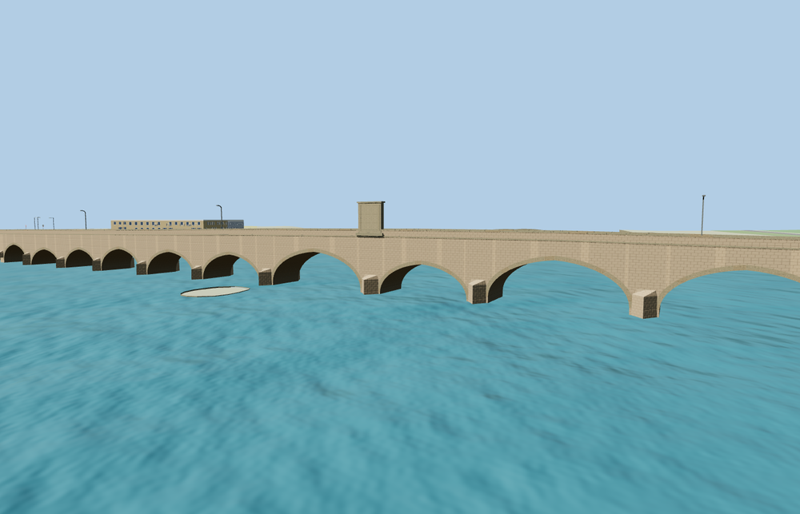

# Mustafa Pasha Bridge, Svilengrad

A gently rising historic stone bridge over the Maritsa with 21 modeled vaults, unequal spans, angled cutwaters, low parapets and a raised rectangular inscription monument at the crest.

The 17,192-triangle source master rebuilds from the editable geometry. The four runtime levels have 986, 3,860, 7,736, 12,152 triangles. Skyline and district total 373,360 bytes. All six GLBs validate with zero errors, warnings or embedded images.

All four viewer levels passed six landing probes within 1.9 cm, 39 deck-height probes and 20 pier contacts. Sixteen arch centers remain open above the native terrain, including 15 over the river. The model replaces the mapped centerline and its duplicate ground-level paving polygon. The viewer retains the surrounding roads, 153 buildings, terrain, river and other landcover. Both map features return if loading fails.

Inspected 25 geographic and 11 standalone views. The arch spacing, deck crest, plaque relief and cutwaters follow ordinary photographs and the mapped 294 m alignment. Five of the 21 modeled arch centers are partly or fully masked by the unchanged native banks. The 8 m western approach sample is about 25 cm above the nominal profile near the existing junction. Foundations and river clearances are visual approximations. Physical-device performance remains unmeasured.

Run `node packages/worldgen/scripts/generate-old-bridge.mjs --check --ids=old_bridge` to confirm the source rebuild.
