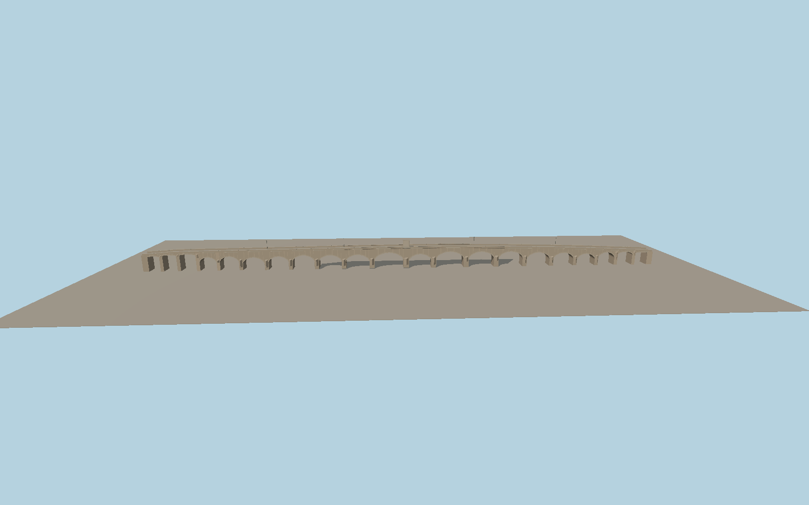

# Mustafa Pasha Bridge

A gently rising historic stone bridge over the Maritsa with 21 modeled vaults, unequal spans, angled cutwaters, low parapets and a raised rectangular inscription monument at the crest.

Run `node packages/worldgen/scripts/generate-old-bridge.mjs` to rebuild the source master. Append `--check` to compare the exact bytes. Use `--ids=old_bridge` for targeted import, LOD generation and placement.

The mapped pedestrian bridge is 294.0 m long. The arch distribution, deck crown and plaque relief are reconstructed from exterior photographs. Vegetation obscures a few terminal bays.

The river and banks use the viewer’s standard terrain. Foundation embedment and water clearance are approximate. The plaque preserves its relief and frame without reproducing readable text.

Original geometry follows the repository license. Map data is © OpenStreetMap contributors under ODbL-1.0 via Protomaps. Terrain samples are described in terrain-grid.json. Ordinary pictures stay local and are not redistributed or used as textures. Current acceptance is recorded in qa.json.
