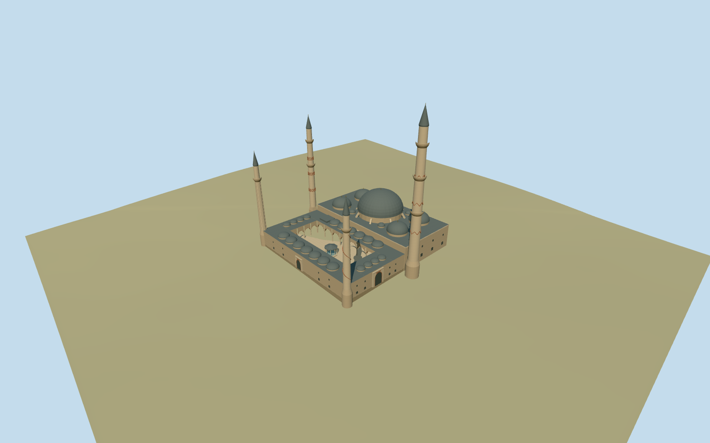

# Üç Şerefeli Mosque

Üç Şerefeli Mosque with its 24-metre dome, arcaded courtyard, fountain and four distinct minarets.

Authoring state: **review-in-qa.json**. Current completion evidence is in [qa.json](qa.json) and the [completion ledger](../../../../qualla-structures/batches/qualla-003.PROGRESS.md).

- [Üç Şerefeli Mosque](https://qualla.com/uc-serefeli-mosque/)

The rectangular bodies follow the map and the comparative architectural survey. Roof and masonry details, the placement of the two northern minarets, their secondary heights and the ornament are approximate.

The separate madrasa buildings, graveyard, interior and calligraphy are outside scope. The fountain canopy and entrance steps are simplified.

Original open regional elevation is preserved. Paving and street geometry around the historic exterior are approximate.

Build: `node content/worldgen/source/places/sx/sx6/uc_serefeli_mosque/models/generate-uc-serefeli-mosque.mjs`. Add `--check` to verify exact regeneration. 25746 triangles; 5 materials; no embedded photographs.
