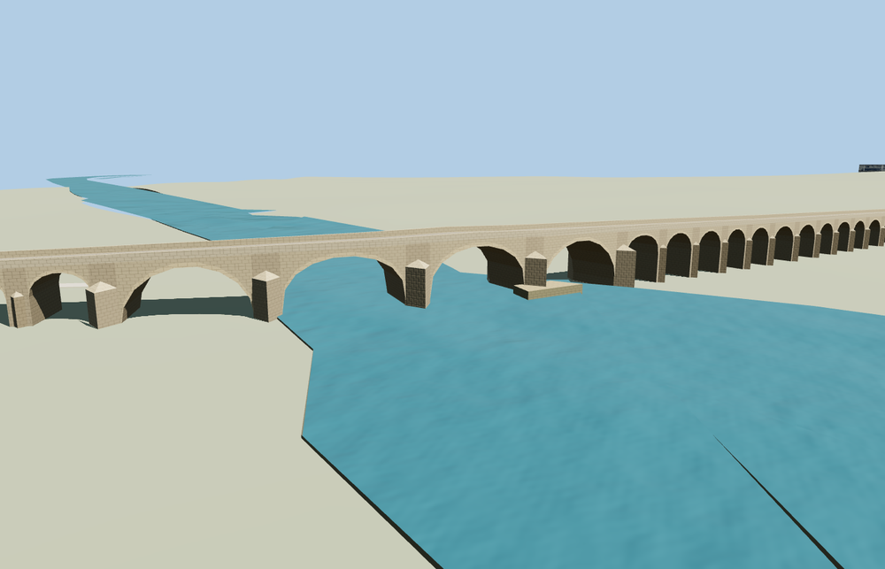

# Uzunköprü Bridge

The full visible Uzunköprü crossing with 164 stone arch bays, larger river openings, pointed cutwaters, low parapets and fitted northwest and southeastern landings.

The 24,256-triangle source rebuilds byte for byte. Skyline, district, street and close-up use 980, 3,916, 11,476, 19,296 triangles. The first two tiers total 340,880 bytes. Six GLBs validated and 38 current views were inspected.

All four tiers pass six landing checks and four river opening probes. The largest sampled deck-to-approach difference is 0.062 m. Street and close-up pass all 164 opening probes. The viewer keeps the original terrain and river, 128 nearby buildings and the parallel modern route. Failed loading restores both mapped parts of the historic road.

The 1,264.81 m length follows the combined PMTiles centerline. Edirne lists a surviving length of 1,272 m and 164 standing arches. The older 1,392 m and 174-arch figures are retained separately. The 164-bay schedule approximates individual spacings and arch profiles from the ordinary aerial and bank views. The current model covers the visible exterior. It leaves the native river, floodplain and nearby modern roads in place. The skyline preserves the four river openings and selected floodplain arch silhouettes. District shows 84 physical vaults. Street and close-up retain all 164. The model does not express operational access or restoration dates. Physical-device timings are unmeasured.

Rebuild with `node packages/worldgen/scripts/generate-uzunkopru-bridge.mjs`. Append `--check` to compare exact bytes. Use `--ids=uzunkopru_bridge` for targeted import, LOD, placement and readiness.
