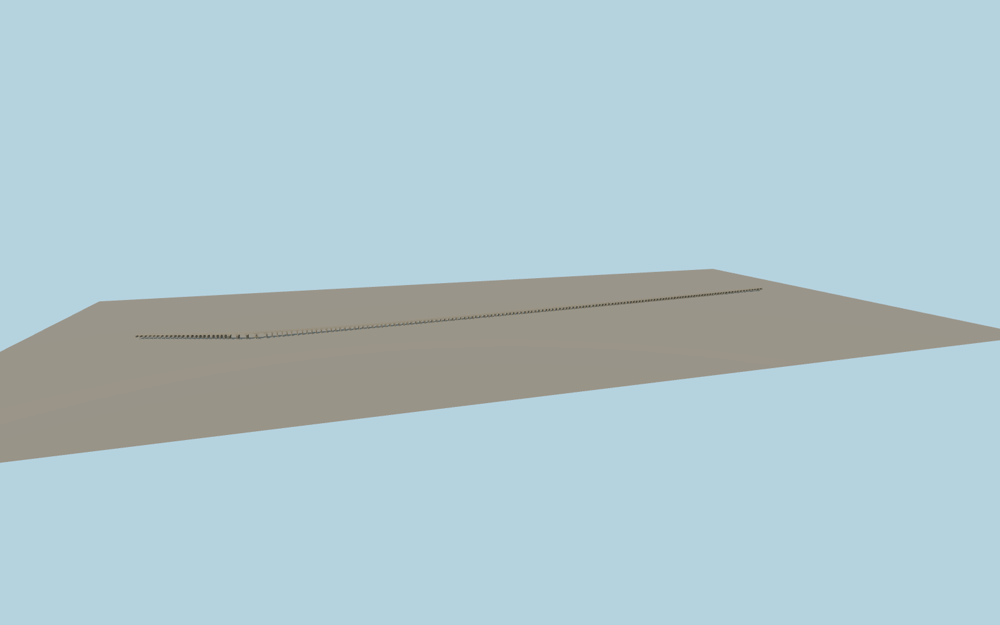

# Uzunköprü Bridge

The full visible Uzunköprü crossing with 164 stone arch bays, larger river openings, pointed cutwaters, low parapets and fitted northwest and southeastern landings.

Run `node packages/worldgen/scripts/generate-uzunkopru-bridge.mjs` to rebuild the source master. Append `--check` to compare the exact bytes. Use `--ids=uzunkopru_bridge` for targeted import, LOD generation and placement.

The 1,264.81 m length follows the combined PMTiles centerline. Edirne lists a surviving length of 1,272 m and 164 standing arches. The older 1,392 m and 174-arch figures are retained separately.

The 164-bay schedule approximates individual spacings and arch profiles from the ordinary aerial and bank views. The current model covers the visible exterior. It leaves the native river, floodplain and nearby modern roads in place.

The skyline preserves the four river openings and selected floodplain arch silhouettes. District shows 84 physical vaults. Street and close-up retain all 164. The model does not express operational access or restoration dates.

Original geometry follows the repository license. Map data is © OpenStreetMap contributors under ODbL-1.0 via Protomaps. Terrain samples are described in terrain-grid.json. Ordinary pictures stay local and are not redistributed or used as textures. Current acceptance:qa.json.
