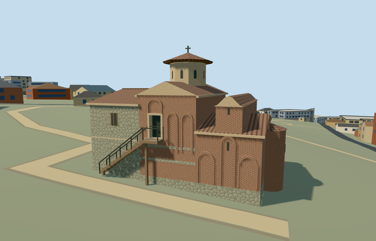

# boyana_church — Boyana Church

Reviewed2026-10-22. **Completed medium-fi church exterior; qualified approximate native fit.**

## Built and inspected

Principal connected Boyana Church exterior: stone western annex, taller brick middle body with raised south doorway and supported exterior stair/landing/rails, lower eastern church with curved roof crown and rounded brick apse/slit window, blind brick arcades and octagonal plaster drum/tiled cap/cross. Upper door is an actual 0.35m recess with jambs, soffit and threshold. Corrected the missing apse, dark upper door and metric brick UV consistency and closed roof/eave undersides during the same author/inspect/fix pass. Arcades and small windows are closed exterior proxies, not traversable openings.

## Shared materials and LODs

Six existing 256px shared graphs and six roles: brick, stone_drywall, plaster_lime, tile_ceramic, wood_plain and metal_painted. Metric UVs: brick 1.92 x 0.90m, fieldstone 2m repeat. No embedded image, private atlas or new graph. One skyline draw; six textured draws. Separate POSITION/NORMAL streams and equal CPU/GPU geometry bytes. Each graph reads once per textured native run; unload releases geometry.

| Level | Triangles | Bytes | Draws |
| --- | ---: | ---: | ---: |
| skyline | 260 | 25232 | 1 |
| district | 1208 | 110048 | 6 |
| street | 1836 | 166676 | 6 |
| closeup | 2208 | 196720 | 6 |

Four authored LODs 260 / 1208 / 1836 / 2208 triangles; initial skyline+district geometry 135280 bytes, closeup 196720 bytes. Six GLBs zero Khronos errors/warnings; 190 actual mesh/contact probes and one intersecting detailed PMTiles case at level 15 (levels 13/14 have no intersecting building records in the extract). Inspected 52 current portable/shared/medium-fi/native frames. All LODs/failure/unload preserve 880 resident / 994 wider independent buildings, original 201x201/6m terrain/roads/289.053m² water and garden/approach ground. Failure keeps all 881 originals; unload restores ground/water and zero live geometry.

## Geographic fit

Q276553 and named church way44890267/native35184416979099 establish the single owned building. Current standard PMTiles supplies the approximately 13.9 x 9.5m rectangular footprint; the older georeference has the same identity and long axis. Internal +X points east/slightly south toward the lower church; +Z south toward the photographed stair. Native east/up/south coordinates are baked with heading 0. Three construction volumes and local roof treatment are picture-led approximations from the mapped perimeter and photographs. Unrelated buildings remain independent. Qualified approximate native exterior fit on original standard Protomaps20261020/Mapzen 201x201/6m terrain. Uncovered western approach datum 775.2697762814635m, floor +0.15m and foundation -1.554m. Boundary grades -1.404..-0.007m leave an exposed downhill foundation; inspected stair/doorway and approach remain clear. Original samples are retained. Only one owned parent is replaced; 880 resident / 994 wider independent buildings, roads and 289.053m² water remain. Exact historic terrain, paving, step levels and accessibility are unverified. Apse projection and unseen elevations are approximate. No bespoke terrain or flattening.

## Fidelity and limits

Picture-led medium-fi reconstruction: west annex eave 5.6m/ridge 6.7m, middle eave 6.3m/ridge 7.3m, lower east eave 3.8m with raised center gable to 6.3m, octagonal drum 7.0..9.0m and overhanging tiled cap to 9.9m; schematic cross reaches 10.5m. Source map height 5m and one level are unqualified controls, not survey. South landing/door threshold 3.05m, actual 0.35m recess, stair proportions reconstructed. Heights, inventories, north/east faces, roof junctions, exact paving/step levels are unverified. No authored historic frescoes or furnished rooms. An additional ordinary eastern exterior photo shows the rounded brick apse and curved roof crown. The source map simplifies this as a rectangle: the added 1.45m apse projection and its 3.55m wall/4.05m roof are picture-led approximations, not surveyed map geometry. Only the owned parent is replaced; the added apse has its own occupied ground mask. Upper doorway back uses shared dark painted metal; triangle and quad brick UVs now use the same metric repeat. Native fit is qualified: original coarse ground slopes about 1.4m across the rectangle and exposes the downhill foundation. Steps, upper doorway and inspected approach remain clear. Northern/other unseen elevations, roof junctions, internal subdivisions and architectural heights remain reconstructed; the apse projection is photograph-led and extends beyond the simplified mapped rectangle. Exact paving, step levels and accessibility are unverified. No copied frescoes, inscriptions, garden monuments or furnished rooms. Physical phone/laptop and dense-city timings remain pending.

## Targeted checks

Selected generation/import/placement, strict medium-fi, scene/sim30 and recipe lint pass. Sim30 sha256:1e10af3765becbe6320eca05a7d430338d622830b5104c1e9530aec7c09e2150. Current pins: [qa.json](qa.json); [source controls](map-frame.json).

## Viewed references

- https://commons.wikimedia.org/wiki/File:Boyana_Church_5.jpg — Ivano Giambattista; 2021-05-06; CC0-1.0. Viewed only; no copied pixels.

- https://commons.wikimedia.org/wiki/File:Boyana_Church_6.jpg — Ivano Giambattista; 2021-05-06; CC0-1.0. Viewed only; no copied pixels.

- https://commons.wikimedia.org/wiki/File:Boyana_Church_7.jpg — Ivano Giambattista; 2021-05-06; CC0-1.0. Viewed only; no copied pixels.

- https://commons.wikimedia.org/wiki/File:Boyana_Church_1.jpg — Aleksander Dragnes; 2007-07-26; CC-BY-2.0. Viewed only; no copied pixels.

- https://www.bhfieldschool.org/excursions/boyana-church-unesco-world-heritage-site-bulgaria — Balkan Heritage Field School; individual photographer not identified; Not specified on the image; No reuse license established; viewed only, no pixels copied or shipped. Viewed only; no copied pixels.

- https://www.openstreetmap.org/way/44890267 — single church identity; ©OpenStreetMap contributors, ODbL-1.0. Standard PMTiles/Mapzen only.

## Completion checklist

- [x] Rebuildable master/import, four authored LODs and shared materials.
- [x] Current actual architecture/context/native renders and geometry checked.
- [x] Explicit identity/orientation, exact ownership union and qualified native exterior fit.
- [x] Garden/approaches open; independent buildings/roads/terrain/water retained; failed loading/unload restoration checked.
