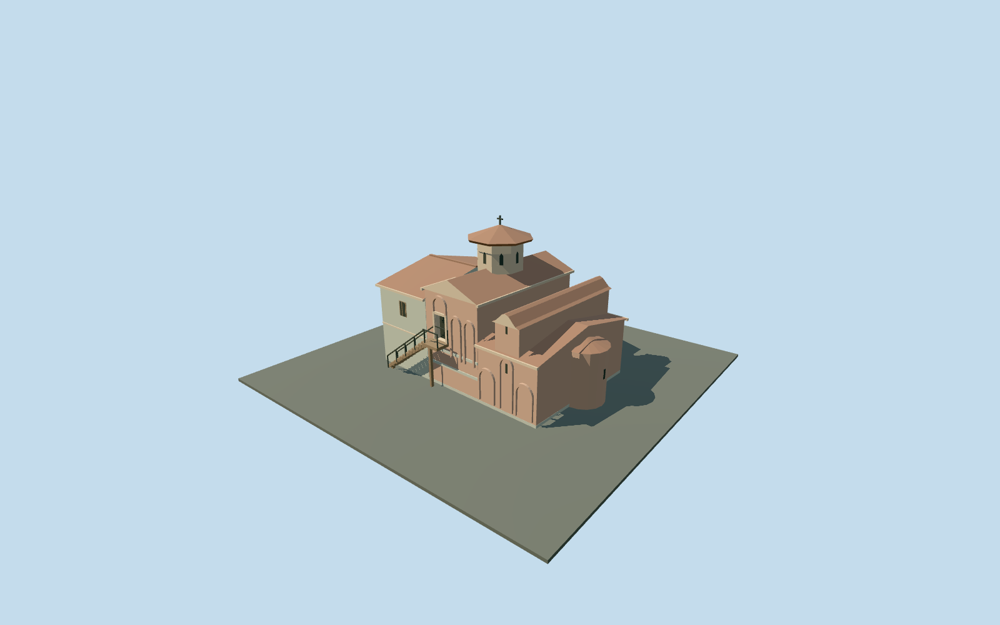

# Boyana Church, brick arcades and stone annex

Principal connected Boyana Church exterior: stone western annex, taller brick middle bay with south exterior stair/raised door, lower eastern church with rounded apse and curved roof crown, red ceramic gables and octagonal tiled drum/cap/cross. Arched blind brickwork is raised framing over closed wall, with narrow dark window proxies. Upper door has an actual shallow recess, jambs, soffit, threshold and supported landing. Unseen northern/eastern elevations, internal subdivisions are conservative reconstructions. No fresco copies, furnished interior, garden monuments or surrounding buildings.

## Evidence and reconstruction

Published dimensions and reconstructed details are separated in spec.json. Primary references:

- [Reference](https://commons.wikimedia.org/wiki/File:Boyana_Church_5.jpg)
- [Reference](https://commons.wikimedia.org/wiki/File:Boyana_Church_6.jpg)
- [Reference](https://commons.wikimedia.org/wiki/File:Boyana_Church_7.jpg)
- [Reference](https://commons.wikimedia.org/wiki/File:Boyana_Church_1.jpg)
- [Reference](https://www.bhfieldschool.org/excursions/boyana-church-unesco-world-heritage-site-bulgaria)

Principal connected Boyana Church exterior: stone western annex, taller brick middle bay with south exterior stair/raised door, lower eastern church with rounded apse and curved roof crown, red ceramic gables and octagonal tiled drum/cap/cross. Arched blind brickwork is raised framing over closed wall, with narrow dark window proxies. Upper door has an actual shallow recess, jambs, soffit, threshold and supported landing. Unseen northern/eastern elevations, internal subdivisions are conservative reconstructions. No fresco copies, furnished interior, garden monuments or surrounding buildings.

## Model and axes

2,208 triangles; 5,236 vertices; 6 material groups; 218,848 bytes. Native bounds: -7.311, -1.554, -5.328 to 8.461, 10.650, 5.740. Source hash: `sha256:a78d271052d0f54a9697bf89a594f302ba6b4fd44a116734490b662990c245af`.

{"x":"east","y":"up","z":"south"}

The geographic proposal uses exact-QID OpenStreetMap evidence. Map-derived orientation and estimated architectural details require real-site visual review; preview eligibility is distinct from geographic/fidelity approval. Map attribution: © OpenStreetMap contributors, ODbL-1.0.

## Reproduce

Run `node packages/worldgen/scripts/generate-additional-landmarks.mjs --ids=boyana_church` (or add `--check`). The generator preserves manually edited masters by checking their baseline hashes. Import through the standard authored-model workflow with optimization disabled; then capture all QA cameras, including shared-surface views.

## Pending work

- Principal connected Boyana Church exterior: stone western annex, taller brick middle bay with south exterior stair/raised door, lower eastern church with rounded apse and curved roof crown, red ceramic gables and octagonal tiled drum/cap/cross. Arched blind brickwork is raised framing over closed wall, with narrow dark window proxies. Upper door has an actual shallow recess, jambs, soffit, threshold and supported landing. Unseen northern/eastern elevations, internal subdivisions are conservative reconstructions. No fresco copies, furnished interior, garden monuments or surrounding buildings.
- Q276553 and named church way44890267/native35184416979099 establish the single owned building. Current standard PMTiles supplies the approximately 13.9 x 9.5m rectangular footprint; the older georeference has the same identity and long axis. Internal +X points east/slightly south toward the lower church; +Z south toward the photographed stair. Native east/up/south coordinates are baked with heading 0. Three construction volumes and local roof treatment are picture-led approximations from the mapped perimeter and photographs. Unrelated buildings remain independent.
- Picture-led medium-fi reconstruction: west annex eave 5.6m/ridge 6.7m, middle eave 6.3m/ridge 7.3m, lower east eave 3.8m with raised center gable to 6.3m, octagonal drum 7.0..9.0m and overhanging tiled cap to 9.9m; schematic cross reaches 10.5m. Source map height 5m and one level are unqualified controls, not survey. South landing/door threshold 3.05m, actual 0.35m recess, stair proportions reconstructed. Heights, inventories, north/east faces, roof junctions, exact paving/step levels are unverified. No authored historic frescoes or furnished rooms. An additional ordinary eastern exterior photo shows the rounded brick apse and curved roof crown. The source map simplifies this as a rectangle: the added 1.45m apse projection and its 3.55m wall/4.05m roof are picture-led approximations, not surveyed map geometry. Only the owned parent is replaced; the added apse has its own occupied ground mask. Upper doorway back uses shared dark painted metal; triangle and quad brick UVs now use the same metric repeat.
- Qualified approximate native exterior fit on original standard Protomaps20261020/Mapzen 201x201/6m terrain. Uncovered western approach datum 775.2697762814635m, floor +0.15m and foundation -1.554m. Boundary grades -1.404..-0.007m leave an exposed downhill foundation; inspected stair/doorway and approach remain clear. Original samples are retained. Only one owned parent is replaced; 880 resident / 994 wider independent buildings, roads and 289.053m² water remain. Exact historic terrain, paving, step levels and accessibility are unverified. Apse projection and unseen elevations are approximate. No bespoke terrain or flattening.

This bundle follows the medium-fi standard. Medium-fi appearance and geographic fit are reviewed separately. Hash-bound visual acceptance is recorded separately after capture inspection.
