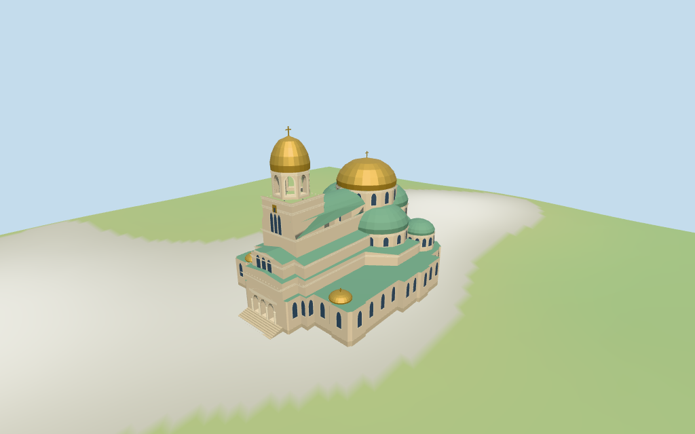

# Alexander Nevsky Cathedral

Individual Sofia cathedral exterior with broad eastern gold dome, taller western open belfry/gold cap/cross, green subsidiary domes/roof layers, stacked apses, arched window bands, triple west closed portals/porch columns/steps and selected stone cornices/icon motifs.

## Evidence and reconstruction

Published dimensions and reconstructed details are separated in spec.json. Primary references:

- [Reference](https://www.bgonair.bg/a/2-bulgaria/392840-zatvaryat-ulitsi-v-tsentara-na-sofiya-zaradi-kontsertite-na-28-i-29-avgust)
- [Reference](https://pikabu.ru/story/khrampamyatnik_aleksandra_nevskogo__sobor_v_sofii_bolgariya_3841004)

Five existing shared256-square graphs supply limestone walls, marble trim, patinated copper, foundation limestone and wooden doors. Linear colors/metricUVs; gold and glazing use simple vertex colors. No unique facade bitmap or embedded image.

## Model and axes

18,216 triangles; 54,648 vertices; 7 material groups; 2,190,060 bytes. Native bounds: -40.300, -1.301, -28.145 to 35.970, 53.650, 28.060. Source hash: `sha256:8186fc8e7b4aff59b4e74a6c22a4d42c9c3246fe1edde7a8b51ebe84859828eb`.

{"x":"east toward apse/main gold dome","y":"up","z":"south"}

Two inspected aerial/front pictures and standard viewer PMTiles/DEM guide this individual cathedral exterior. Exact plaza/doorstep levels, icons/sculpture and full interiors remain outside scope. ©OpenStreetMap contributors,ODbL-1.0.

## Reproduce

Run `node packages/worldgen/scripts/generate-additional-landmarks.mjs --ids=N0329` (or add `--check`). The generator preserves manually edited masters by checking their baseline hashes. Import through the standard authored-model workflow with optimization disabled; then capture all QA cameras, including shared-surface views.

## Pending work

- Mapped parent/part footprints and nominal height intervals are retained; subdivisions of wall/drum/roof, semicircular profiles, window rhythm, portico detail and cornices are picture-led estimates. Full circular component controls overlap to form joined subsidiary half-domes; masked caps retain supporting volumes.
- NativeY0 follows standardDEM559.522m. Estimated0.65m common floor, foundations, entrance steps and exact plaza/doorstep joins are approximate. No surveyed elevation, flood behavior or certified walking/interior collision.
- Skyline preserves two prominent gold crowns, stepped green subsidiary roofs/apses and western entry with simpler masses/surface belfry panes. District restores actual belfry cuts and principal facade/windows; street/closeup add secondary window bands, porch columns, cornice detail and steps. Surface glazing and closed entrance doors do not reconstruct interiors.
- Small icon panels use original simple color motifs. Exact icons, inscriptions, sculpture, reliefs, crypt/interiors and structural plans are excluded; surrounding plaza/city/vegetation remain host content. Physical laptop/phone measurements remain pending.

This bundle follows the medium-fi standard. Medium-fi appearance and geographic fit are reviewed separately. Hash-bound visual acceptance is recorded separately after capture inspection.

## Additional geographic data

©OpenStreetMap contributors; Protomaps; Mapzen/USGS terrain tiles.
