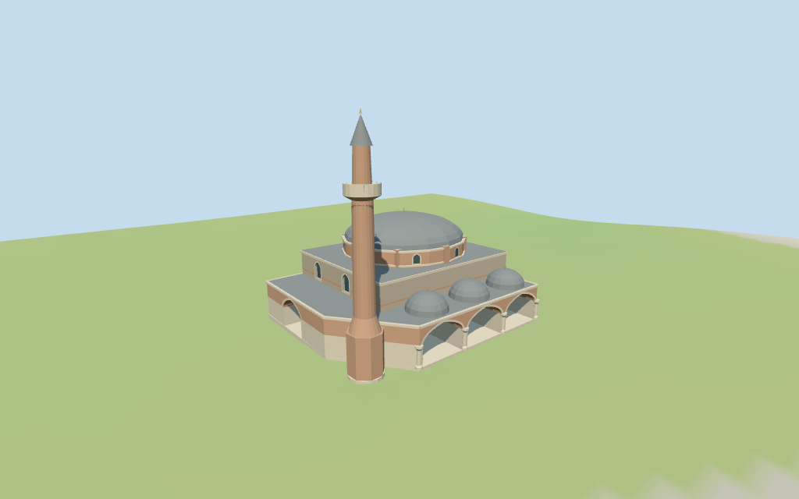

# Banya Bashi Mosque

Individual Banya Bashi Mosque: retained mosque footprint,low L-shaped range with a three-domed pointed-arch portico,mixed stone/brick prayer hall,polygonal buttressed brick drum,shallow metal dome and one brick minaret with projecting pale balcony and pointed metal cone. Fine inscriptions,historic lattice artwork,fences,trees,people and furnished interiors are omitted. The front assignment and partitions are approximate.

## Evidence and reconstruction

Published dimensions and reconstructed details are separated in spec.json. Primary references:

- [Reference](https://commons.wikimedia.org/wiki/File:Banya_Bashi_Mosque_in_Sofia.jpg)

Six shared256² longformat brick,dry stone,raw limestone,standing-seam metal,plain wood and cast bronze graphs;seven merged roles including opaque palette glazing. Metric UVs,linear tints,no embedded images,unique facade atlas,copied lattice/inscriptions or baked illumination.

## Model and axes

6,288 triangles; 18,864 vertices; 7 material groups; 758,816 bytes. Native bounds: -13.964, -0.498, -12.494 to 14.402, 26.833, 12.562. Source hash: `sha256:5eab01ce3aeaf7629a1031e84d765d6f2047a0661f53ccb8eae7e01377cc20d9`.

{"x":"retained mosque long axis","y":"up","z":"estimated front toward+Z"}

Ordinary viewer Protomaps20261014 and Mapzen/USGS extractN0471;datum 547.3272221712853 m. 298 footprint samples span -0.14285289357269448 to 0.31624144631928175 m. Floor 0.33335584814210506 m equals the median of 68 outer samples plus0.25 m. Foundations sample outline edges at<=2 m. Ground replacement is limited to the retained main outline,including its tower bulge. Surrounding park,streets and neighboring buildings stay host content. Preview DEM seats this mask only;exact thresholds,steps and street joins remain unverified.

## Reproduce

Run `node packages/worldgen/scripts/generate-additional-landmarks.mjs --ids=N0471` (or add `--check`). The generator preserves manually edited masters by checking their baseline hashes. Import through the standard authored-model workflow with optimization disabled; then capture all QA cameras, including shared-surface views.

## Pending work

- Retained Q790052 /way96640830 anchor,axis and23-vertex outline remain unchanged. Current named mosque/main polygon plus tower,roof and low L-shaped part guide internal massing. Map heights14,26 and5 m are nominal tags,not independent measurements. The three-domed front is assigned to +Z,with one lower west-side range;facade facing,part roles,wall/roof partitions and finer dimensions remain picture-guided approximations. The current mosque POI/main polygon share id35184468729662. The roof polygon supplies the dome center/plan;the tower and lower L-shaped part guide the remaining masses. No additional mosque or nearby building is included.
- Retained dimensional facts are empty. Current nominal PMTiles tags are main14 m,tower26 m and lower part5 m. These tags guide massing,not a measured vertical datum. Main walls8.5 m,drum10.6 m,dome14 m plus0.8 m finial;low plate5 m plus small domes about7.3 m;tower cone26 m plus0.5 m tip. All partitions,roof rise,finials and aperture dimensions are visualization estimates;tag26 is preserved separately from the modeled26.5 m total.
- Ordinary viewer Protomaps20261014 and Mapzen/USGS extractN0471;datum 547.3272221712853 m. 298 footprint samples span -0.14285289357269448 to 0.31624144631928175 m. Floor 0.33335584814210506 m equals the median of 68 outer samples plus0.25 m. Foundations sample outline edges at<=2 m. Ground replacement is limited to the retained main outline,including its tower bulge. Surrounding park,streets and neighboring buildings stay host content. Preview DEM seats this mask only;exact thresholds,steps and street joins remain unverified.
- One inspected2012 picture guides the metal dome,buttressed brick drum,three-front-arch portico and single pale-balcony minaret. Current mapped roof,tower and low L-shaped part guide massing;their roles and the front assignment remain estimates. The retained whole outline is the ground mask. Opaque door/window fields close the exterior hall;portico passages are shallow and unfurnished. Exact current finish,lattice motifs,roof construction,engineering,steps/street joins and physical-device timing are unverified. Neighboring park,streets and buildings remain host content.

This bundle follows the medium-fi standard. Medium-fi appearance and geographic fit are reviewed separately. Hash-bound visual acceptance is recorded separately after capture inspection.

## Additional geographic data

©OpenStreetMap contributors;Protomaps;Mapzen/USGS terrain.
