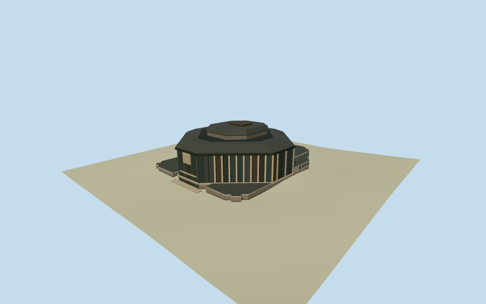

# National Palace of Culture

Sofia’s National Palace of Culture with polygonal roofs, glazed entrance, pale pilasters, and a broad stone podium.

Authoring state: **review-in-qa.json**. Current completion evidence is in [qa.json](qa.json) and the [completion ledger](../../../../qualla-structures/batches/qualla-004.PROGRESS.md).

- [National Palace of Culture](https://qualla.com/national-palace-of-culture/)

The model includes the principal palace. The detached landscape, fountains, plaza monuments and underground facilities sit outside the model scope.

Glazing subdivisions and the secondary elevations are approximated where the confirmed photo is incomplete. The original sculpture on the entrance panel is omitted.

Build: `node content/worldgen/source/places/sx/sx8/national_palace_of_culture/models/generate-national-palace-of-culture.mjs`. Add `--check` to verify exact regeneration. 6563 triangles; 6 materials; no embedded photographs.
