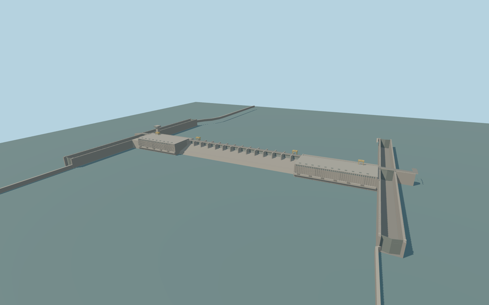

# Iron Gate I Hydroelectric Power Station

Iron Gate I international crossing, central spillway, Serbian and Romanian turbine halls, observation tower, both two-stage navigation locks and their approach walls.

Rebuild: `node packages/worldgen/scripts/generate-iron-gate-i.mjs`;append `--check` for exact source bytes. Select import/LOD/placement with `--ids=iron_gate_i_hydroelectric_power_station`. Detailed source and four browser tiers are separate ignored GLB outputs.

The standard Terrarium upstream sample at [0, −520] gives a 58 m model datum. The Danube reference at [10, 570] is 18 m below it. The production water sampler returned 58.65 m upstream and 40.65 m downstream in the retained probe windows.

The two navigation chambers per bank, miter gates, passage walls, twin power halls and central barrage use the signed map and visible exterior. Stage levels and the machinery are visual interpretations.

The standard 16 m terrain and modeled shoreline contacts are approximate. The live viewer samples water independently, while the four review planes show an illustrative lock cycle.

Only the mapped barrage crossing and owned composite building shell are replaced. The separate Romanian service bridge is preserved at the joint.

Original geometry:repository license. Map:© OpenStreetMap contributors,ODbL-1.0;Protomaps. Standard terrain:terrain-grid.json. Ordinary pictures stay local and are not redistributed or used as textures. Current acceptance:qa.json.
