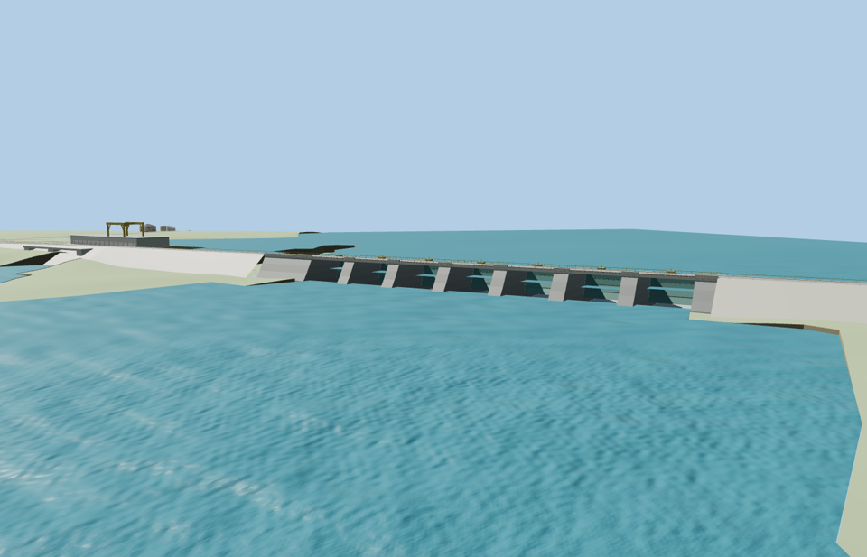

# Iron Gate II Gogoșu spillway and powerhouse

Reviewed 2026-11-18. Available as a **World Explorer preview**.

The model shows the seven recessed gates, concrete piers, island powerhouse and yellow roof gantry. The fixed placement follows DN56B. At the two road joins, the rendered pavement heights differ by less than 1 cm across the sampled lanes in all four detail levels. The stock viewer uses a 41 m upstream pool and a terrain-derived tailwater of about 33.65 m at the sampled point. Bank slopes, shoreline edges and equipment positions are approximate at this map and terrain resolution. [Placement evidence](placement-report.json) · [Reference photographs](https://www.revistaconstructiilor.eu/wp-content/uploads/2015/03/rc_nr_112_martie_2015.pdf#page=31)

The viewer replaces only the selected DN56B segments and the matching powerhouse footprint. A failed load preserves the mapped fallbacks. Unloading restores the terrain openings and releases model geometry. The approaches were also tested with no bridge feature in the input tile.

The source master has 3,434 triangles. The skyline and district levels total 96,564 bytes. Six GLBs pass validation with zero embedded images. All 132 geometry probes passed, and the four detail levels rebuild byte for byte. [QA](qa.json)

[Iron Gate II main crossing](../iron_gate_ii_hydroelectric_power_station/QA-REVIEW.md) · [Romanian locks](../iron_gate_ii_romanian_locks/QA-REVIEW.md)
