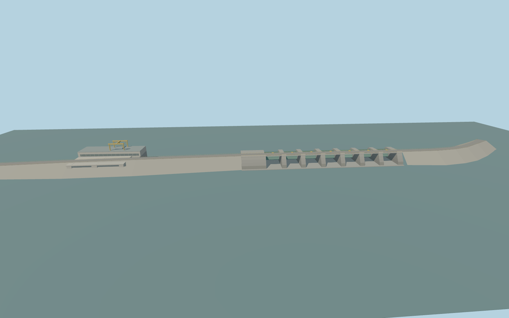

# Iron Gate II Gogoșu spillway and powerhouse

Gogoșu branch crossing with seven recessed green gates, concrete piers, a continuous road crest, wing embankments and the separate Romanian auxiliary powerhouse with its yellow gantry.

Part of [Iron Gate II](../iron_gate_ii_hydroelectric_power_station/QA-REVIEW.md). The model is available as an Earth preview with mapped DN56B road joins. [Map and picture evidence](reference-observations.json)

Rebuild with node content/worldgen/source/places/sx/sxb/iron_gate_ii_gogosu/models/generate-gogosu.mjs. Import and LOD generation accept --ids=iron_gate_ii_gogosu.
