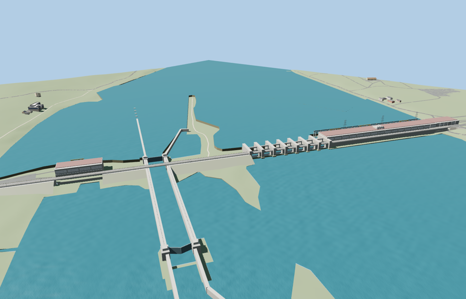

# Iron Gate II Hydroelectric Power Station

**Ready.** Reviewed 43 current asset renders and 18 stock Earth views, including the load-failure fallback.

The main border crossing includes the two halves of the sixteen-unit powerhouse, the two-unit Serbian auxiliary building, seven recessed radial-gate bays, ochre crest rails, cranes and intake masts. The 310 × 34 m Serbian lock has an open chamber, upstream and downstream gates, long guide walls and a road crossing.

Both named PMTiles bridge lines control the signed 0.9712059653 radian frame and the authored crest centerline. Local +X follows the crest northeast and +Z points downstream. Native water and building polygons locate the plants and Serbian chamber. The production road replacement removes the covered border crossing and preserves nearby roads and the separate DN56B bridge.

Seven shared graphs supply concrete, earth, painted steel, sheet roofing and window grids. The six GLBs have zero embedded images. Viewer eviction disposes the geometry and restores native terrain.

Thirteen standard Terrarium tiles supply the riverbanks. The reference fixture uses 41 m headwater, 33.65 m tailwater and an illustrative 37.1 m chamber. The sampled fixture uses 35.65 m headwater and approximately 33.65 m in both the tailwater and the chamber.

Skyline plus district total 318,496 bytes. The four detail levels have 894, 2,944, 9,336 and 11,808 triangles and rebuild byte for byte. Six GLBs pass Khronos validation with zero embedded images.

The Gogoșu spillway and powerhouse and the Romanian locks stream as separate components with four detail levels each. The production regional loader selects each at its mapped site. The static exteriors use approximate local deck elevations, pier sections and equipment positions. [Gogoșu](../iron_gate_ii_gogosu/QA-REVIEW.md) · [Romanian locks](../iron_gate_ii_romanian_locks/QA-REVIEW.md)

Rebuild with `node packages/worldgen/scripts/generate-iron-gate-ii.mjs`. Append `--check` to check exact source bytes. Select import, LOD generation and readiness with `--ids=iron_gate_ii_hydroelectric_power_station`.

The stock Earth water renderer places the main headwater and the upstream Serbian lock lead at 41 m. The Serbian chamber and downstream reach retain their terrain-derived elevations. [Water-stage checks](placement-report.json) · [Normal pool reference](https://www.revistaconstructiilor.eu/wp-content/uploads/2015/03/rc_nr_112_martie_2015.pdf#page=31)

Both road approaches meet the authored crest within 4 cm at the sampled lane positions across all four detail levels. The Serbian end matches the angle and width of the incoming road. Nearby bridges stay visible, and unloading the model restores the terrain openings. [Road and placement checks](placement-report.json)
