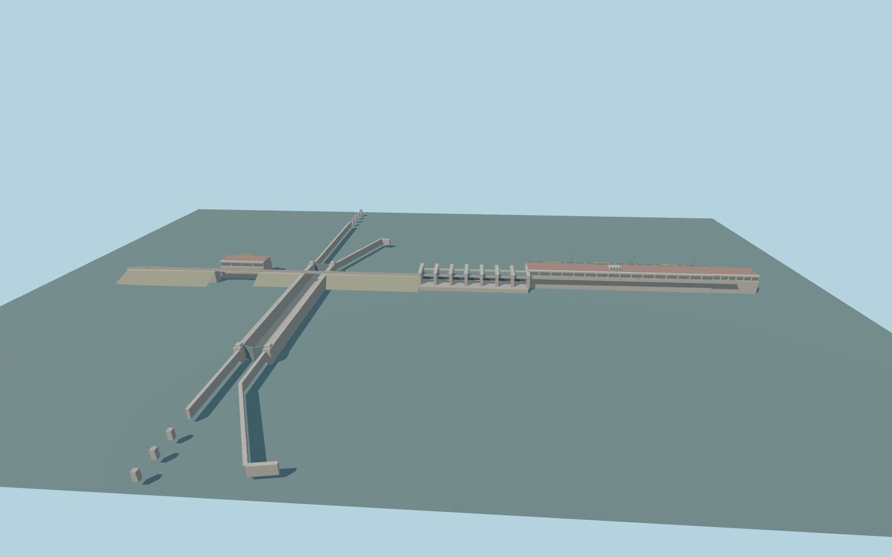

# Iron Gate II Hydroelectric Power Station

Main Iron Gate II crossing with the two sections of the sixteen-unit powerhouse, Serbian two-unit auxiliary plant, seven-bay spillway, 310 × 34 m Serbian navigation chamber, guide walls and 1,135 m crest road.

Rebuild: `node packages/worldgen/scripts/generate-iron-gate-ii.mjs`;append `--check` for exact source bytes. Select import/LOD/placement with `--ids=iron_gate_ii_hydroelectric_power_station`. Detailed source and four browser tiers are separate ignored GLB outputs.

Fixed 34.99451425 m model datum and approximate 46 m deck. Standard viewer sampling gives 35.65 m headwater, 33.65 m tailwater and 33.65 m in the chamber. Reference headwater is 41 m and the comparison chamber stage is 37.1 m.

The candidate includes a wider two-branch hydropower system. This model covers its main border crossing. The independently located Romanian island locks and Gogoșu powerhouse and spillway remain pending.

The standard water sampler puts upstream water 5.35 m below the documented normal pool. Reference and native sampled fixtures keep both results explicit. Control equipment, exact pier grades and buried structures are visual approximations.

The static exterior preserves the open lock chamber, both gates, crest road, main and auxiliary plants and long guide walls. It omits interior equipment and operating water flows.

Original geometry:repository license. Map:© OpenStreetMap contributors,ODbL-1.0;Protomaps. Standard terrain:terrain-grid.json. Ordinary pictures stay local and are not redistributed or used as textures. Current acceptance:qa.json.
