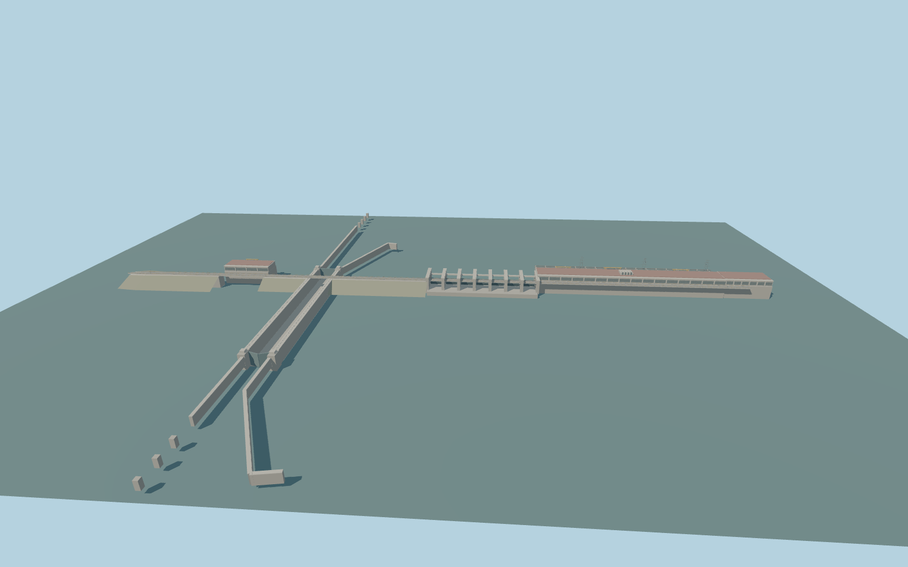

# Iron Gate II Hydroelectric Power Station

Main Iron Gate II crossing with the two sections of the sixteen-unit powerhouse, Serbian two-unit auxiliary plant, seven-bay spillway, 310 × 34 m Serbian navigation chamber, guide walls and 1,135 m crest road.

Rebuild: `node packages/worldgen/scripts/generate-iron-gate-ii.mjs`;append `--check` for exact source bytes. Select import/LOD/placement with `--ids=iron_gate_ii_hydroelectric_power_station`. Detailed source and four browser tiers are separate ignored GLB outputs.

The main border crossing, the Romanian locks and the Gogoșu spillway and powerhouse are separate geographic placements.

The Earth renderer uses the documented 41 m normal pool on the upstream side. The lock chamber and tailwater use sampled stages. The older comparison fixtures retain their recorded water levels.

Exact pier grades, equipment positions and buried geometry are approximate. The Romanian main lock lower gate follows its published chamber length.

The static exterior depicts the navigation chambers, gates, crest roads, powerhouses, spillway and guide walls. It omits interiors and operating flows.

Original geometry:repository license. Map:© OpenStreetMap contributors,ODbL-1.0;Protomaps. Standard terrain:terrain-grid.json. Ordinary pictures stay local and are not redistributed or used as textures. Current acceptance:qa.json.
