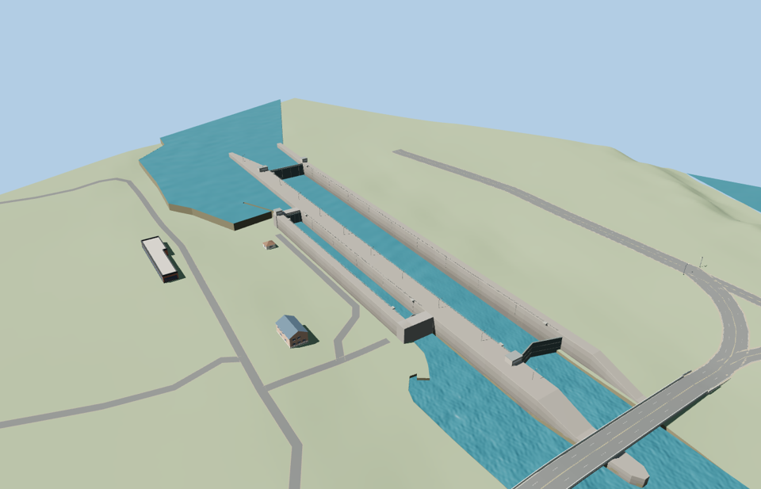

# Iron Gate II Romanian navigation locks

Reviewed 2026-11-18. Available as a **World Explorer preview**.

The reserve chamber and common divider follow PMTiles. The main chamber’s downstream gate follows the mapped upstream head and the published chamber length. Exact coping, floor and downstream guide wall elevations are approximate. [Map and picture evidence](reference-observations.json)

The guide walls taper below the mapped DN56B bridge. The stock viewer retains the native road geometry and drew about 0.86 m or more between the top of the wall and the pavement at the sampled points. The authored floors remain below the sampled chamber water. The upstream approaches render at 41 m. The two chambers preserve their distinct sampled stages. [Placement evidence](placement-report.json)

Six GLBs pass glTF validation with no embedded images. All 84 geometry probes passed, and the four detail levels rebuild byte for byte. The skyline and district levels total 88,888 bytes. The renderer restores terrain on unloading and retains the mapped fallback on load failure. [QA](qa.json)

[Main Iron Gate II crossing](../iron_gate_ii_hydroelectric_power_station/QA-REVIEW.md) · [Gogoșu](../iron_gate_ii_gogosu/QA-REVIEW.md)
